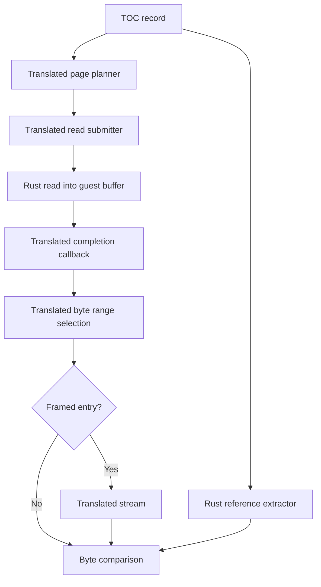

# Warframe U5.1 cache recompilation internals

This document describes v0.10.0 and the 32-bit Windows build `2012.12.31.16.20`.
The project recompiles parts of the game's synchronous path for reading and
decoding a nonempty whole cache entry. Run the project with the commands in
[README.md](README.md).

## From the executable to native code

`lift.py` reads the PE32 image base and section table, maps the
selected relative virtual addresses (RVAs) to file offsets, and checks the
SHA-256 digest of each selected byte range. The decoder's digest includes its
32-entry jump table. The reference `Warframe.exe` has SHA-256
`614c08f25b531d590c5aa6d9cf35b1e406e83d35fbd50e61188f19247fb176ae`.
Generation checks the relevant ranges so an executable with unrelated changes
can still work if those ranges and their addresses match. [lift.py](lift.py)

Capstone decodes the instructions when the script runs. The script groups
instructions into basic blocks and emits Rust statements for register,
memory, and flag operations. Branches select the next compiled block by its
original x86 address. The generated code models 32-bit registers and pointers,
carry and zero flags, and the low 64 bits of `xmm0` used by the selected SSE
instructions. It also preserves guest stack behavior across calls and returns,
including callee stack cleanup where the original specifies it. The host
enters the translated code with a zero return address, which marks the return
to Rust. The page span selector returns at a fixed instruction boundary with
its results in `EDI` and `ESI`.

Cargo compiles the generated `src/lifted.rs` and the Rust harness for the host.
The executable serves as input to generation. At run time the harness uses
the compiled routines and the installation's `Cache.Windows` directory.

## Cache entry path

The Rust reader takes an offset, packed
length, and decoded length from the TOC. It handles little-endian TOC versions
16 and 20 with 96-byte records. Archive page boundaries and compression block
boundaries are distinct. [src/cache.rs](src/cache.rs)

| Unit | How it is used |
| --- | --- |
| Archive page | `CalculateReadPages` chooses the byte span and inclusive 64 KiB page range. `StartIOBufferLoad` converts each page index to an aligned offset and submits a 64 KiB `ReadFileEx` request. `LoadBufferIntoOp` selects the entry bytes within a ready page. |
| Unframed entry | When the TOC lengths are equal, the bytes read from the archive are the entry contents. |
| Framed entry | When the TOC lengths differ, the entry contains frames. Each starts with two big-endian 16-bit lengths, packed first and decoded second. This stream path accepts frames up to 16 KiB. |
| Stored frame | Within a framed entry, equal frame lengths select a byte copy. A smaller packed frame length selects LZ decompression. |



The archive wrapper prepares a guest archive operation for a whole-entry
read, calls the translated planner, and checks that the returned range fits
that entry. It then supplies one guest I/O buffer and file-handle token per
page. The translated submitter writes the 64-bit offset into the guest
`OVERLAPPED` record and passes it to the `ReadFileEx` bridge. Rust seeks to
that offset and reads into the guest buffer. The host retains that guest
state and calls the x86 callback with the byte count and the original
`OVERLAPPED` pointer. The translated completion code finds the buffer in the
thread's array, sets its state from pending (`1`) to ready (`3`), and calls
the semaphore bridge. The host checks for the ready state and one signal,
then passes a guest operation with the entry offset, bytes consumed, and
bytes remaining to the translated prefix of `LoadBufferIntoOp`. The prefix
verifies the page index and file, checks that the operation holds the buffer,
and clamps the range to the end of the current page. At `0x004AA70C`, `EDI`
points to the first byte and `ESI` points one byte past the selected range.
The host checks both pointers against the page and the actual transfer before
appending those bytes. A short final page is accepted when it contains the
entire selected range. [src/archive.rs](src/archive.rs)

The stream wrapper supplies guest memory and
passes the complete framed entry to the translated synchronous setup. The
engine code advances through the entry, including refills when it needs to
stage input. The host checks all frame bounds before entry, then checks the
consumed and produced lengths and each LZ call's returned length before
copying the result to the caller. [src/lib.rs](src/lib.rs)

## Asset preview

The preview finds `Temp/Lotus/Interface/SigninReward/0_flashu.bmp` in
`B.TextureDx9.toc` and reads it with the same translated archive and stream
code as the verifier. That shared entry reader uses the corresponding
`B.TextureDx9.cache` and the decoded length declared by the TOC. The
verifier's separate reference decoder is only used for comparisons.
[src/main.rs](src/main.rs) · [src/preview.rs](src/preview.rs)

This specific cooked texture contains 43,708 bytes of BGRA mip levels ordered
from smallest to largest. The final 32,768 bytes are the 256 × 32 top level.
The preview composites the pixels over black and gives GDI a top-down
32-bit DIB. Rust supplies process startup, window creation, and the event
loop. The translated game code supplies archive reads and decompression.
[src/window.rs](src/window.rs)

## Routine map

The addresses below are virtual addresses at the reference image base
`0x00400000`. Subtract the base for the RVA used by `lift.py`. Where the
original name is unavailable, the role describes the observed behavior.

| Address | Role |
| --- | --- |
| `0x00445B80` | Call `ReleaseSemaphore` to signal that the cache thread has work ready. |
| `0x004A5C60` | `CacheThreadImpl::CalculateReadPages`. Compute the byte span and first and last archive pages. |
| `0x004A6B00` | `CacheThreadImpl::FinishIOBufferLoad`. Locate the pending buffer, mark it ready, update the I/O counters, and signal. |
| `0x004A6BA0` | Check the `ReadFileEx` completion status and byte count, then dispatch to `FinishIOBufferLoad`. |
| `0x004A6C20` | `CacheThreadImpl::StartIOBufferLoad`. Fill the per-page request and call `ReadFileEx`. |
| `0x004AA550`–`0x004AA70C` (end exclusive) | `CacheThreadImpl::LoadBufferIntoOp` prefix. Validate the ready buffer and compute the guest pointers shared by the framed and unframed paths. |
| `0x004B1C10` | Call the LZ decoder and report the produced length through an output pointer. Exposed by the standalone `decode_block` helper. |
| `0x004B3290` | Query the output buffer's memory attributes for the stream setup. |
| `0x004B3460` | Construct a stream and initialize its scratch pointers. |
| `0x004B3550` | Calculate space available in the output buffer. |
| `0x004B3590` | Flush staged output into the destination. |
| `0x004B3620` | Copy a stored frame or call the LZ decoder for a compressed frame. |
| `0x004B3730` | Refill staging when input is split at a ring-buffer boundary. |
| `0x004B3860` | Read the next frame header and advance the input ring. |
| `0x004B3930` | Drive decompression of a whole framed entry. |
| `0x004B3AA0` | Bind the input and output buffers, choose the output mode, dispatch to the synchronous driver, and report lengths. |
| `0x00F372B0` | Decode one LZ payload. The literal-run jump table begins at `0x00F37458`. |

## Host calls and supported paths

| Boundary | Harness behavior |
| --- | --- |
| Scratch allocation at `0x00415390` | Supply a single 16-byte-aligned `0xC004`-byte region in the guest arena. |
| Memory move at `0x00F18440` | Use Rust's overlap-safe `copy_within`. |
| `KERNEL32!VirtualQuery` through `0x010A7170` | Return a 32-bit memory-information record for ordinary read/write memory. This lets the translated setup select direct output. |
| `KERNEL32!QueryPerformanceCounter` through `0x010A709C` | Supply a deterministic zero timestamp for the submitter's timing counters. |
| `KERNEL32!ReadFileEx` through `0x010A71F4` | Capture the request and retain the guest destination and `OVERLAPPED` pointer for completion. Rust serves one page at a time. |
| `KERNEL32!ReleaseSemaphore` through `0x010A719C` | Validate the guest semaphore token and record one release for the current page. |
| Engine diagnostics, interleaving, and job submission | Report an unsupported path if the generated code reaches one of these boundaries. |

The current host supplies TOC reading, synchronous file I/O, and delivery of
successful completions. The translation covers whole-entry planning from the
beginning of an entry, the page submission and completion routines, page
span selection, and ordinary synchronous stream setup. Rust assembles the
selected spans and passes the packed bytes to the translated stream for
framed entries. The original copy and stream-feed branches after the span
checkpoint, buffer release, and the surrounding I/O queue are future
integration points.

## Verification

The reference decoder is the handwritten implementation from the extractor.
The test harness compares
it with the lifted read and decode path byte for byte. A stored frame is
counted within a framed entry, while an unframed entry contributes to its own
entry count. [src/cache.rs](src/cache.rs) · [src/main.rs](src/main.rs)

| Run | Framed entries | Unframed entries | Stored frames | Compressed frames |
| --- | ---: | ---: | ---: | ---: |
| v0.9.0, archived cache, default sample | 40 | 9 | 1 | 187 |
| v0.8.0, Windows install with English cache variants, default sample | 44 | 12 | 1 | 192 |
| v0.9.0, archived cache, full comparison | 16,793 | 1,331 | 1,302 | 95,871 |

The full comparison used the same harness path with every nonempty entry
selected. The original x86 page planner was also run independently for all
18,124 archived entries to verify the inclusive page ranges. The original
x86 submitter and completion path were checked at all 5,303 distinct page
indices used by that archive set and at two synthetic short transfers above
4 GiB. Running the original x86 span selector independently matched all
29,917 page spans used by those entries and three synthetic entries above
or crossing 4 GiB. The v0.8.0 Windows sample covered 25 archives with
compressed frames and passed 17 unit tests. The v0.9.0 Linux run passed 18,
including a check that the selector accepts a ready buffer above 4 GiB and
rejects a pending buffer.

The v0.10.0 Linux run passed 19 unit tests and matched the v0.9.0 default
sample counts. The preview decoded the asset's three compressed frames.
A test harness supplied stand-ins for the Win32 window and paint functions
and compared all 32,768 bytes sent to the paint call with the independently
extracted and composited texture. The user's native Windows run also passed
all 19 unit tests and displayed the 256 × 32 SigninReward texture with
`--window`.

## Extending the translation

Start with the exact routine range and the same reference executable. Record
which argument registers, stack slots, return values, and side effects its
caller uses. Verify direct and indirect branch targets before adding the range
and digest to `lift.py`. If a routine crosses into a host call, document the
calling convention and the behavior the host must provide. Add a focused test
for the new behavior and compare it with the original x86 before expanding the
cache sample. Edit the generator or its Rust host code and regenerate
`src/lifted.rs` to try the change.

## Verified startup checkpoint (2026-11-19, Windows)

The next milestone is implemented locally on top of v0.10.0. The native
executable now enters translated code at the original PE entry point and
reaches `STARTUP_COOKIE_READY`. This is the first CRT initialization step;
it does not yet run WinMain, initialize the engine, or display the title screen.

### Entry path and discovery

The verified PE32 AddressOfEntryPoint is RVA `0x00B17D46` (VA
`0x00F17D46`). Its `call 0x00F23039` initializes the CRT security cookie,
returns to `0x00F17D4B`, then jumps to `0x00F17BD9`. We stop before executing
that jump destination and name it `STARTUP_COOKIE_READY`. The initializer
writes the cookie at `0x01310B30` and its bitwise complement at `0x01310B34`.

`lift.py` now also invokes `startup_lift.py`, producing the ignored local
`src/startup_lifted.rs`. The startup lift checks the full reference executable
SHA-256 listed above and the PE entry point. Recursive discovery begins at
the entry, follows direct calls, unconditional branches, both conditional
successors, and call continuations, and terminates at returns or explicit
checkpoints. It discovers 56 instructions within the entry range
`[0x00F17D46, 0x00F17D50)` and initializer range
`[0x00F23039, 0x00F230D4)`. These bounds admit the selected routines without
prelisting their blocks or branch targets. Unreachable bytes are not decoded.

Discovery rejects unsupported instructions, indirect calls/imports, overlapping
instructions, truncated instructions, and out-of-scope targets with their
addresses. Both discovery and execution have a 512-step/instruction budget.
Four synthetic-PE Python tests cover calls, branches, unreachable bytes,
checkpoints, rejected targets/imports/instructions, overlap, truncation, and
the discovery budget. The shared instruction translator now supports `not`
and `leave`; startup emits Rust using that translator and original stack
call/return conventions. The established cache emitter remains in use.

### Rust and Windows API boundary

`src/startup.rs` supplies zeroed guest memory, ESP `0x00020000`, zero initial
registers, a selected initial cookie, and an intentionally stale complement
`0xDEADBEEF`. Rust supplies these deterministic import fixtures; the translated
original instructions combine the values, select the initialization branch,
and write both globals. These fixtures are for verification, not production
security entropy. The import names were checked against the original PE import
table, all in `KERNEL32.dll`:

| IAT slot | Import | Fixture |
| --- | --- | --- |
| `0x010A7268` | `GetSystemTimeAsFileTime` | Writes `0x1122334455667788` through its argument. |
| `0x010A7138` | `GetCurrentProcessId` | Returns `0x1234`. |
| `0x010A7154` | `GetCurrentThreadId` | Returns `0x5678`. |
| `0x010A7304` | `GetTickCount` | Returns the selected entropy XOR all other entropy components. |
| `0x010A709C` | `QueryPerformanceCounter` | Writes `0x0102030405060708`, returns 1. |

The pointer-taking imports consume one stdcall argument; the other imports
consume none. The FILETIME fixture also sets EAX to 1 for repeatability,
although that void API's return register is not used. The initialized-cookie
path calls none of these imports. The startup fixture is separate from the
cache's existing zero-timestamp counter shim.

### Independent original-x86 comparison

`verify_startup.py` runs the original PE machine bytes in Unicorn 2.1.4 x86-32
on Windows. It maps the original sections, starts at the PE entry, replaces
only the five IAT slots with hooked API fixtures, and stops at `0x00F17BD9`.
It does not execute generated Rust or implement the cookie algorithm in Python.
It compares both globals, final ESP, and the ordered import-slot trace with
output from the native release executable under the same initial state and
API inputs. This is emulated original x86, not a live launch of Warframe.exe.

All six cases matched, with ESP restored to `0x00020000` in each:

| Initial cookie | Combined entropy | Final cookie | Complement | API calls |
| --- | --- | --- | --- | ---: |
| `BB40E64E` | `12345678` | `12345678` | `EDCBA987` | 5 |
| `87654321` | `12345678` | `87654321` | `789ABCDE` | 0 |
| `BB40E64E` | `BB40E64E` | `BB40E64F` | `44BF19B0` | 5 |
| `BB40E64E` | `00001234` | `57351234` | `A8CAEDCB` | 5 |
| `00001234` | `00000000` | `47110000` | `B8EEFFFF` | 5 |
| `BB40E64E` | `FFFF0000` | `FFFF0000` | `0000FFFF` | 5 |

The oracle checks that these runs collectively execute all 56 discovered
instructions, and fails on mismatches, missing coverage, or an execution
budget failure. This covers the existing-cookie shortcut, ordinary seeding,
default-cookie collision, and high-word repair.

### Reproduce and regression results

Run from CMD in the repository root. Install verification dependencies once:

```cmd
py -m pip install -r requirements-verify.txt
verify-startup.cmd "D:\Warframe 2012"
```

The script generates both Rust translations, runs Python discovery tests,
runs Cargo tests and the release build offline, performs the x86 comparison,
and runs the cache and asset checks. It stops on any failure. For just the
compiled checkpoint (no original executable or cache read needed):

```cmd
target\release\warframe-u51-decoder-recomp.exe . --startup
```

Verified locally on Windows on 2026-11-19:

- Four Python discovery tests passed.
- All 20 Rust unit tests passed (17 library and 3 executable tests; baseline
  19 plus the startup branch test). Release build passed without warnings.
- `PASS: 6 original-x86 comparisons; all 56 reachable instructions exercised.`
- Cache sample: 44 framed entries, 12 unframed entries, one stored frame,
  `PASS: 192 compressed blocks matched across 25 archives.`
- Asset: 43,708 decoded bytes, 256 x 32 pixels, three compressed frames.

No window/rendering code was changed for this milestone. The optional
`--window` desktop check was not rerun. All results above are headless.
Original installation files were read only; generated translations remain
ignored and no original code bytes or extracted assets are added to Git.

### Next concrete boundary

The last verified checkpoint is `0x00F17BD9`. The next startup instructions
push `0x58` and `0x01286050`, then call `0x00F21D70` at `0x00F17BE0`.
That exception-registration helper first pushes handler `0x00F19540`, then
executes `push dword ptr fs:[0]` at `0x00F21D75`. The current lifter rejects
this segment-relative memory access. The next step is to model the guest
TEB/SEH chain and verify this prologue before admitting it into the scope.
Do not skip its stack/frame effects.

After the helper, calls at `0x00F17BE9` and `0x00F17BFE` use unresolved IAT
slots `0x010A7280` (`GetStartupInfoW`) and `0x010A727C`
(`HeapSetInformation`), respectively. The PE-header check at `0x00F17C09`
also uses a 16-bit memory/register comparison, outside the present operand
support. These instructions and imports were inspected, not executed or
claimed as translated by this milestone.

## SEH registration and PE classification verified (2026-11-19)

The previous `fs:[0]` boundary is now translated. Recursive startup discovery
covers 108 instructions through `0x00F17C4D`, retaining the cookie checkpoint.
Additional checkpoints are `0x00F17BE5` (SEH prologue returned) and
`0x00F17C4D` (startup information and PE classification ready), reported as
`STARTUP_FRAME_READY` with the stop address.

Rust supplies a guest TEB at `0x10000`; segment-relative operands address this
TEB. The original helper at `0x00F21D70` builds the registration record and
writes its head. It preserves the supplied previous chain (`FFFFFFFF` or
`00018000`), installs handler `00F19540`, and encodes the scope-table pointer
using the translated security cookie. At both checkpoints ESP is `0001FF84`,
EBP is `0001FFFC`, and `fs:[0]` is `0001FFEC`. This implements registration,
not exception dispatch or unwinding yet.

The startup prefix now calls fixture `GetStartupInfoW` (68-byte zeroed record
with cb=68) and, when the original global selects it, `HeapSetInformation`
with verified arguments `(NULL, 1, NULL, 0)` and success return. Original
instructions inspect locally generated PE header bytes and select the managed
image flag at `[EBP-0x1C]`. Six header fixtures cover the actual PE and invalid
DOS signature, invalid PE signature, wrong optional-header magic, too few data
directories, and a nonzero CLR directory. These are verification fixtures;
production process startup and real heap behavior remain to be integrated.

The x86 oracle now uses actual GDT descriptors (32-bit CS/DS/ES/SS and a
nonzero-base FS), so original segment instructions execute unmodified.
Twelve frame cases compare the whole 144-byte stack region, EBP, ESP, the
TEB head, and ordered import calls. This exposed missing residual import
return-address writes in the translation; the emitter now models those calls'
stack writes as well as argument cleanup. PUSH also evaluates its source
before decrementing ESP, required for stack-relative source operands.

`verify-startup.cmd "D:\Warframe 2012"` passed: 20 Rust tests, four Python
discovery tests, six cookie comparisons and twelve frame comparisons with all
108 discovered instructions exercised, plus unchanged cache (192 compressed
blocks / 25 archives) and asset (43,708 bytes / 256 x 32) results. No server
was used. The title screen and playable tutorial are not reached yet.

Next action: translate the CRT heap initialization called at `00F17C4D`
(target `00F2301B`), then thread/runtime initialization. Later login/tutorial
launch arguments are `-webserver:http://localhost/api/ -language:ru -fullscreen:0`;
use the same arguments for the recompiled executable once its launch path is
available. Title-screen verification must remain independent of the server.

## Heap creation and TLS API selection verified (2026-11-19)

The startup group now discovers 162 instructions. Translated `00F2301B`
calls `HeapCreate` through slot `010A7300` with `(0, 0x1000, 0)`, stores the
result at `01358C78`, and converts it to a boolean. The success path enters
`00F22EA0`; the failure case is stopped at `00F17C56` before CRT error handling.
The CRT looks up KERNEL32 with `GetModuleHandleW` (`010A70A4`), then resolves
FlsAlloc/FlsGetValue/FlsSetValue/FlsFree using `GetProcAddress` (`010A70A8`).
The four register-indirect calls at `00F22ECA`, `00F22ED7`, `00F22EE4`, and
`00F22EF1` are now translated with an explicit checked import target.

At `00F22F41`, all four returned APIs are installed in globals
`01358C68`/`6C`/`70`/`74` if present. If any is absent, original instructions
select the whole TLS fallback group: original wrapper `00F22B05`, TlsGetValue
(`010A72EC`), TlsSetValue (`010A72F0`), and TlsFree (`010A72F4`). Original
module/API strings are read from locally generated, ignored initializer data.
Import slots use deterministic guest tokens in both the translation and oracle.

Eight new x86 comparisons cover heap failure, module lookup failure, complete
FLS availability, no FLS availability, and each missing FLS API individually.
All match EAX, ESP, EBP, the heap global, four dispatch globals, and ordered
API calls. This verifies dispatch selection, not yet TLS allocation or use.
Heap/module handles and procedure results are still explicit test fixtures.

`verify-startup.cmd "D:\Warframe 2012"` passed again: 20 Rust tests, four
Python tests, 26 original-x86 cases, every one of 162 discovered instructions,
and unchanged cache and asset checks. Next action: original TlsAlloc at
`00F22F41`, TlsSetValue at `00F22F5C`, encoded API pointers, and CRT lock/thread
state initialization. No server is involved in these process-startup steps.

## TLS state and encoded callbacks verified (2026-11-19)

Startup discovery now covers 249 instructions, stopping at `00F22FA5` before
CRT lock initialization. Original code calls TlsAlloc (`010A7088`), writes its
index to `01310EF4`, and uses TlsSetValue (`010A72F0`) to store the selected
getter. It then calls the group rooted at `00F20730`, including seven newly
reachable small routines, to initialize encoded null/callback globals before
encoding the four TLS/FLS dispatch pointers.

The EncodePointer fixture (`010A7284`) uses the named
`STARTUP_FIXTURE_POINTER_XOR` value `A5A55A5A`; this represents an opaque
reversible encoding for comparisons, not a claim about Windows' private
encoding algorithm. It is confined to `--startup`'s deterministic `Memory`
host and the Unicorn verifier. A native boot path must call the real Win32
EncodePointer/DecodePointer imports. The selected callback at `00F2E465` is encoded
but not invoked. TLS fixtures retain the stored value and validate the index.
Four additional original-x86 cases cover FLS and TLS success, TlsAlloc failure,
and TlsSetValue failure; failures stop at `00F23016` before cleanup. All 30
cases (six cookie, twelve frame, twelve runtime) match, covering all 249
instructions. Runtime comparisons include nine newly initialized callback
globals, the TLS index/value, and the four encoded dispatch pointers.

`verify-startup.cmd "D:\Warframe 2012"` passes with unchanged tests/cache/asset
results. Next: translate CRT lock-table traversal at `00F21BBC`, including the
signed loop branch at `00F21BF2` and InitializeCriticalSectionAndSpinCount
through `010A71A4`. This remains process initialization; no title screen yet.

## CRT lock table verified (2026-11-19)

The group now discovers 276 instructions and reaches `00F22FAA` after the
original lock initializer at `00F21BBC` returns. The original 36-entry static
lock table is included in ignored generated initializer data. The loop creates
14 critical-section records in the successful case, using 24-byte guest
records beginning at `013580B8`. Translated code writes their pointers to the
lock table; the API fixture validates spin count 4000 and initializes the
record. Failing the first or seventh API call returns EAX=0 and clears the
failed table pointer; success returns EAX=1.

Three more original-x86 comparisons verify the full 288-byte pointer/type
table and 864-byte critical-section storage, in addition to existing runtime
state and call traces. All 33 cases match and exercise all 276 instructions.
The execution budget is now 4096 instructions to accommodate the loop.
The translator supports the loop's signed `jl` using CMP's width-correct SF
and OF; it rejects signed branches without an immediately preceding CMP or
with alternate direct entries, rather than silently reusing stale flags.

`verify-startup.cmd "D:\Warframe 2012"` passes the startup/cache/asset checks.
The last verified startup state is CRT locks ready at `00F22FAA`; the next
step is decoding and invoking the selected FlsAlloc/TlsAlloc function at
`00F22FBF`/`00F22FC1`, allocating the `0x214`-byte per-thread CRT data block
through `00F22053`, and initializing it through `00F22BBC`. API fixtures still
need a production backend; actual engine/window startup remains ahead.

## Per-thread TLS/FLS slot verified (2026-11-19)

The next prefix decodes the selected allocator and executes the indirect call
at `00F22FC1`. The generator now supports a verified indirect target set that
can contain both imports and original guest functions. FLS uses the host
FlsAlloc token with original cleanup callback `00F22D03`; TLS fallback executes
the original wrapper at `00F22B05`, including its `ret 4` argument cleanup.
This call is not replaced with a handwritten shortcut.

The allocated per-thread slot is stored at `01310EF0`. Four added x86 cases
cover FLS/TLS success and failure. Success stops at `00F22FCD` before allocating
the CRT thread-data block, and failure stops at `00F23011` before cleanup.
The verifier compares the new slot along with prior state, stack, and ordered
calls. Both TLS-index initializers now come from original PE data rather than
zero defaults. `verify-startup.cmd "D:\Warframe 2012"` passes all 37 x86 cases,
20 Rust tests, five discovery tests, and cache/asset regressions.
Next: translate calloc's group rooted at `00F22053` / `00F3038D`, then store
and initialize the resulting `0x214`-byte per-thread data block.

## CRT calloc and thread-data allocation verified (2026-11-19)

Discovery now includes the group rooted at `00F22053` and `00F3038D`, adding
32-bit unsigned division and two-operand signed multiplication. The original
calloc code performs its overflow check, multiplies count by element size,
requests zero-filled memory from HeapAlloc (`010A7328`), and handles a null
result. Rust supplies a bounded guest heap; the translated CRT performs the
allocation policy. Division faults report an address instead of wrapping.

At `00F22FE1`, the original startup has allocated its `0x214`-byte thread-data
block at guest `00080000`. A second case reaches the allocation-failure
boundary `00F23011`. Six direct original-x86 allocator cases additionally
exercise zero count, the error-output pointer, overflow rejection at
`00F303A5`, the unimplemented new-handler boundary at `00F303E3`, successful
retry, and retry timeout. Sleep is a recorded deterministic fixture and does
not delay tests. The oracle compares return values, stack cleanup, allocation
attempts, error output, and a 1 KiB heap region initially filled with A5, so
zero-initialization and untouched surrounding memory are both checked.

`verify-startup.cmd "D:\Warframe 2012"` passes: 45 original-x86 cases exercise
all 362 discovered instructions; 20 Rust and five discovery tests pass;
cache and asset checks remain unchanged. Allocator error/new-handler routines
are explicit unresolved boundaries, not replaced with successful behavior.
Next: store the thread-data pointer through the selected FLS/TLS setter, then
translate the initializer at `00F22BBC`, including its nested SEH frame,
locale references, lock acquisition/release, and SEH epilogue.

## CRT per-thread initialization verified (2026-11-19)

The native translated PE path now returns from CRT thread initialization at
`00F17C63` with EAX=1. The group covers 521 instructions. It stores the new
thread-data pointer through the selected FLS/TLS setter, executes `00F22BBC`,
and restores the outer SEH chain through the original epilogue `00F21DB5`.
The thread object contains the original thread ID, invalid-handle sentinel,
C-locale and multibyte pointers, default flags, and character markers.

Locale handling is translated through `00F25870`; Rust supplies only the
InterlockedIncrement boundary. The original code increments all applicable
reference counts. Original lock wrappers acquire/release the initialized
locale locks through modeled critical-section operations. Lazy lock creation
at `00F21D4B` remains an explicit boundary because these startup locks already
exist. Thread/FLS cleanup callbacks are registered but not yet dispatched.

Startup initialization now loads all non-executable PE sections into guest
memory from locally generated `src/startup_data.bin`, which is ignored by Git.
Executable sections are excluded; instructions still run as compiled Rust.
This replaces manually selected initializer slices and makes the original
locale and reference tables available for further engine startup.

The oracle verifies all `0x214` thread-object bytes, the original static locale
region, TLS/FLS contents, lock records, EAX/ESP/EBP, and restored TEB head.
Added cases cover full FLS/TLS success and a setter failure. A synthetic locale
case exercises optional reference pointers and six category entries, comparing
a full 4 KiB region. All 49 original-x86 cases exercise all 521 instructions.
`verify-startup.cmd "D:\Warframe 2012"` passes, including 20 Rust tests, five
Python tests, and unchanged cache and asset results.

Next: the empty CRT initializer range at `00F22AB0`, then low-level CRT file
handle initialization at `00F21DC9`. WinMain is at `00401140` (called from
`00F17CEE`); the remaining CRT path must run before entering it. The game title
screen and tutorial have not been reached. No server or network was used.

## CRT descriptor-table allocation verified (2026-11-19)

The PE path now runs the empty CRT initializer traversal (`00F22AB0` has
identical start/end constants `01285CB0`) and enters low-level I/O setup at
`00F21DC9`. The unneeded initializer callback-body path remains an explicit
boundary at `00F22AC4`; no callback is skipped on the verified path.
Original code allocates 32 64-byte descriptor records, sets invalid-handle and
text-mode defaults, and publishes the pointer/count globals `01359CA0` and
`01359C88`. Success reaches `00F21E42`; a failed second HeapAlloc returns -1
at `00F17C7C`. Both cases match original x86, including all 2048 table bytes.

`verify-startup.cmd "D:\Warframe 2012"` passes 51 original-x86 cases covering
all 579 discovered instructions, with unchanged Rust/discovery/cache/asset
results. Next: initialize stdin/stdout/stderr from GetStdHandle/GetFileType,
then process command-line/environment setup before the CRT initializer arrays.
Inherited CRT descriptor data is a separate path to implement explicitly.

## CRT standard handles verified (2026-11-19)

The supported non-inherited descriptor path now returns from `00F21DC9` to
`00F17C7C`, with EAX=0 on success. Original code requests stdin/stdout/stderr
using GetStdHandle (`010A72D4`), queries GetFileType (`010A72D8`), sets the
text/character/pipe flags, initializes each descriptor's lock, and calls
SetHandleCount (`010A72D0`). Handle tokens and API responses are fixtures;
actual process I/O handles are not yet bridged. This is verified CRT behavior,
not a claim that engine startup or rendering runs.

Eight additional cases cover complete FLS and TLS paths through I/O setup,
a nonzero reserved-data length with null pointer, null standard handles,
INVALID_HANDLE_VALUE, failed file-type queries, a standard-descriptor lock
failure, and the inherited-descriptor boundary. Inherited CRT descriptor data
stops explicitly at `00F21E59`; a pre-populated descriptor path at `00F21F70`
is also deferred. Current fresh tables contain invalid handles, so neither
path is needed for the verified non-inherited startup. The verifier compares
all descriptor bytes, published globals, lock state, thread/locale state,
return values, stack, and call order.

The final `verify-startup.cmd "D:\Warframe 2012"` run passed: 59 original-x86
cases exercised all 643 discovered instructions; all 20 Rust and five Python
tests passed; the cache remained 44 framed / 12 unframed / one stored frame /
192 compressed blocks across 25 archives; the preview asset remained 43,708
bytes and 256 x 32 pixels. Full local output is in ignored
`target/startup-verification.log`. No desktop window or server was used.

Next action: extend the caller from `00F17C7C` through its signed return-value
check, GetCommandLineA (`010A7278`), and the environment getter at `00F22A19`.
The import table confirms GetEnvironmentStringsW (`010A72E4`),
WideCharToMultiByte (`010A72C4`), and FreeEnvironmentStringsW (`010A72E0`).
Environment allocation uses `00F2200E` / `00F26278`. Argument parsing follows
at `00F2295E`, calling `00F227C4`, before the CRT initializer arrays and WinMain
at `00401140`. Preserve `-webserver:http://localhost/api/ -language:ru
-fullscreen:0` for later login/tutorial runs. The title-screen/playable-tutorial
goal remains active and unverified; the next work does not require a server.

## Command line and ANSI environment verified (2026-11-19)

The translated entry path now passes the signed result check at `00F17C7C`,
captures GetCommandLineA (`010A7278`) in `01359DB8`, executes the original CRT
environment converter at `00F22A19`, and publishes its return value in
`01358030` at the named `00F17C9D` checkpoint. Logical instructions now model
SF/OF for TEST and support JNS and arithmetic right shift. The successful
fixture converts the UTF-16 block `A=B\0LANG=ru\0\0` to 13 ANSI bytes at guest
`00080A20`; the null-environment fixture returns zero. Both results, heap state,
stack/frame state, import order, command-line pointer, and converted bytes match
the original x86 under Unicorn.

The allocation path is translated through `00F2200E` and `_malloc` at
`00F26278`. Rust supplies deterministic GetCommandLineA,
GetEnvironmentStringsW, WideCharToMultiByte, FreeEnvironmentStringsW, and
HeapAlloc fixtures. The CRT scans the double-NUL block, computes the character
count, requests the conversion size, allocates, performs the conversion, frees
the Windows environment block, and returns the ANSI pointer. Explicit next-run
boundaries are the prior CRT failure handler `00F17C80`, malloc retry
`00F22026`, conversion cleanup/failure at `00F22A8A`/`00F22AA2`, lazy heap
initialization `00F26291`, zero-size allocation `00F262B1`, allocation failure
`00F262C9`, and oversize allocation `00F262F5`.

REA MCP 6.9.0 was available with the Windows Ghidra provider and opened the
same SHA-256 used by the generator. Focused headless summaries identified
`00F22A19` as `___crtGetEnvironmentStringsA` (retained Evidence
`ev_435ef2c46832809d311635122e8c7aab8f76e653b3328ce072746c01854a3cca`),
`00F26278` as `_malloc`
(`ev_d033217d566803a2f504a11ef5963d576fc34c5ee8941ce8a31282eaa668caa8`),
and the following `00F2295E` routine as `__setargv`
(`ev_597c5e1d6c1069c1b1c0ae4ced16cad5cbbd682d2cf90ee8fc4aba381029d21e`).
The retained environment pseudocode corroborates the translated control flow;
it is static Ghidra evidence, while the Unicorn comparisons establish execution.

`verify-startup.cmd "D:\Warframe 2012"` passes 61 original-x86 comparisons
(six cookie, twelve frame, 34 runtime, six allocator, one locale, and two
environment cases) and exercises all 760 instructions in the supported bounded
group. All 20 Rust tests and five discovery tests pass. Cache regression remains
44 framed entries, 12 unframed entries, one stored frame, and 192 compressed
blocks across 25 archives; the asset remains 43,708 bytes and 256 x 32 pixels.
The output is recorded in ignored `target/startup-verification.log`.

Next: translate `__setargv` at `00F2295E` and its command-line tokenizer at
`00F227C4`, verify argc/argv and copied argument bytes at `0135806C` and
`01358070`, then continue through the remaining CRT initializer arrays toward
WinMain at `00401140`. Preserve the later login/tutorial arguments
`-webserver:http://localhost/api/ -language:ru -fullscreen:0`.

## argv and environment vector verified (2026-11-19)

The translated entry path now executes `__setargv` at `00F2295E`, including
the tokenizer at `00F227C4`, and then the environment-vector initializer at
`00F226E8`. The command-line fixture is `Warframe.exe -language:ru
-fullscreen:0`. At checkpoint `00F17CAE`, both implementations publish argc=3
at `0135806C` and argv=`00080A30` at `01358070`; the three pointers, terminating
null pointer, and copied argument bytes match. At checkpoint `00F17CBF`, both
publish envp=`00080A70` at `01358078`, containing `A=B`, `LANG=ru`, and a null
pointer, and set the initialized flag at `01359DA0` to one. The heap ends at
`00080AA0` in both runs.

The generator gained MOVSX and SETE and discovers the newly reachable direct
calls and branch targets as a group. Rust supplies deterministic
GetModuleFileNameA, strlen, bounded-copy, and free boundaries; original x86
performs command-line counting/copying and environment filtering/allocation.
Quoted/DBCS tokenizer alternatives, allocation failures, the absent-environment
return at `00F22704`, and the already-initialized ctype call at `00F226F1` are
explicit unresolved boundaries. They are not counted as exercised behavior.

`verify-startup.cmd "D:\Warframe 2012"` passes 63 original-x86 comparisons
(six cookie, twelve frame, 34 runtime, six allocator, one locale, two
environment, one argv, and one envp) and exercises all 1,027 instructions in
the supported bounded group. All 20 Rust tests and five Python tests pass. The
cache still matches 44 framed entries, 12 unframed entries, one stored frame,
and 192 compressed blocks across 25 archives; the preview asset remains 43,708
bytes with a 256 x 32 top mip.

Focused headless Ghidra summary requests for `00F226E8` and the next routine
`00F20787` were issued through the available REA MCP server, but did not return
within the client window. Direct inspection identifies the next boundary:
`00F20787` encodes ten runtime pointers via `00F23CB4`, walks the CRT
pre-initializer range `010A99F0..010A9A10` through `00F20763`, registers
`00F22AD6`, then begins the large constructor table at
`010A761C..010A99EC`. Later, `00F22689` derives lpCmdLine and `00F17CEE` calls
WinMain at `00401140`.

Last verified checkpoint: `00F17CBF`, immediately before the call to
`00F20787`. Next: translate the direct path through `00F20787` to the first
indirect pre-initializer boundary, resolve and verify the seven non-null
pre-initializer entries, then continue to `00F22689` and WinMain. The title
screen remains unverified, and no SpaceNinjaServer process or network service
was used by these headless checks.

## CRT pre-initializers verified (2026-11-19)

The translated entry path now enters `__cinit` at `00F20787`. The named
`STARTUP_CINIT_POINTERS_READY` checkpoint at `00F207B3` verifies all ten slots
at `01310EF8..01310F1C` after the original loop at `00F23CB4` encodes them.
The PE's raw-DLL callback is `00F18111`; Rust supplies the executable-image
pointer predicate and raw-DLL callback boundaries while the translated wrapper
performs the tests, arguments, calls, and stack cleanup.

The seven-entry pre-initializer table `010A99F0..010A9A10` is now a closed
indirect target set. Original translated code executes entries `00F179F2`,
`00F182B1`, `00F192AB`, `00F231D7`, `00F25852`, `00F2615A`, and `00F22323`.
At `STARTUP_PREINITIALIZERS_READY` (`00F207C4`), the original and translated
runs agree on the 20-entry CRT stream-pointer table, its pointed-to values,
the encoded 128-byte atexit allocation, captured system time, processor-feature
globals, ctype flag, guest-heap end, registers, stack, and ordered host calls.
Rust supplies deterministic IsProcessorFeaturePresent and
SetUnhandledExceptionFilter results. Allocation retry/failure and alternate
already-sized table branches remain explicit boundaries.

The lifter now supports JGE with validated CMP flag provenance and permits a
verified indirect call set through either a register or an absolute pointer.
Indirect cdecl host boundaries use caller cleanup, matching direct calls.

REA's focused Ghidra fast path identified `00F20787` as `__cinit` and retained
Evidence `ev_a31c5fa1e63e86c8ef4b8f68505cc174d8deae9fd129e9e4f0eceda82eca3a64`.
It identified `00F1831E` as `_atexit` (Evidence
`ev_ac095e1921bd0cdf4a533749192b9764448ae8e707ed6af6a604b2ed8a46fb20`)
and `00F22689` as `__wincmdln` (Evidence
`ev_976504471a805abe41c53830c20dfc3edb359a29e097fae08e226e8800197ebd`).
The earlier summary timeout was a client observation limit; the live REA
session and these later focused results confirm the server and Ghidra provider
remain usable.

`verify-startup.cmd "D:\Warframe 2012"` passes 65 original-x86 comparisons
and exercises all 1,184 instructions in the supported bounded group. All 20
Rust tests and five Python tests pass. Cache and asset evidence remains 44
framed entries, 12 unframed entries, one stored frame, 192 compressed blocks
across 25 archives, and a 43,708-byte 256 x 32 preview asset.

Last verified checkpoint: `00F207C4`, after every CRT pre-initializer returns
zero. Next: translate `_atexit` registration of callback `00F22AD6`, then
inventory and execute the constructor table `010A761C..010A99EC`. After
`__cinit` returns, translate `__wincmdln` and enter WinMain at `00401140`.
The title/login screen and UI input remain unverified. SpaceNinjaServer was not
started or contacted.

## atexit and first constructors verified (2026-11-19)

The original `_atexit` path at `00F1831E` is now translated through its SEH
wrapper, lock acquire/release, encoded callback-table access, and success
normalization. `STARTUP_ATEXIT_READY` at `00F207D4` verifies that callback
`00F22AD6` occupies the first four-byte slot and that the encoded end pointer
advanced exactly once. Rust supplies the allocation-size query for the guest
heap allocation; growth/reallocation and corrupt-pointer branches remain
explicit boundaries.

The constructor table contains 2,292 entries, of which 2,290 are nonzero and
all 2,290 targets are unique. The lifter now admits constructor targets in
measured batches and can stop at the first unresolved target with the same
return address already pushed that the original x86 has at function entry.
This makes each batch directly comparable without pretending later constructors
ran.

The first constructor `010670D0` performs a scalar float multiply and stores
the result at `01316330`. MOVSS and MULSS are now translated with exact f32 bit
rounding. The second constructor `010670F0` invokes the translated leaf object
initializer at `00421AE0`, creates the 13-byte object at `01316334`, and
registers destructor `010912E0` through the translated `_atexit` path.
`STARTUP_CONSTRUCTOR_001_READY` stops at `010670F0`,
`STARTUP_CONSTRUCTOR_002_READY` stops at `01067120`, and the same object shape
at `01067120` is verified by `STARTUP_CONSTRUCTOR_003_READY` at `01067150`.
All three match original x86 registers, stack, written bytes, callback bytes,
and ordered host calls.

Focused Ghidra evidence identifies the second constructor's object initializer
as `FUN_00421ae0`, a 32-byte leaf ending in `ret 0xC` (Evidence
`ev_db173f2dc1b330251694228414482770efdf5e3d20d9fc3da8d979942a67925c`).
The next shared object initializer at `00425060` is retained as Evidence
`ev_69d2bb1464eded720351b5a6120956d659fe484ca9a094201a0f9f10f44eedd3`.

`verify-startup.cmd "D:\Warframe 2012"` passes 69 original-x86 comparisons
and exercises all 1,314 instructions in the bounded group. All 20 Rust tests,
five Python tests, cache checks, and the 43,708-byte asset check pass.

Last verified checkpoint: entry of constructor `01067150`, after the first
three constructors have returned. Next: translate the repeated constructor family
rooted at `00425060` and its direct callees in a batch, continuing until the
first genuinely new constructor shape. The later `__wincmdln`, WinMain, title
screen, and UI-input checks remain outstanding. SpaceNinjaServer remained
stopped.

## Constructors 4 through 466 verified (2026-11-21)

The bounded constructor-table lift now reaches entry `0106B550`, after the
first 305 constructors have returned. Constructor 4 executes the original
object code at `00425060`, `00424B60`, and `00423B70`; Rust supplies narrow
boundaries for `strrchr` at `00F1ABC0`, string-pool initialization at
`00423280`, and string interning at `00423730`. Constructors 5 through 8 reuse
that object family. Constructor 9 executes the SIMD initializer at `00402B40`;
the lifter now models 128-bit XMM state and translates MOVAPS, XORPS, SHUFPS,
MOVQ, MOVSS, and MULSS used by this slice.

Constructors 13 through 22 execute the linked registration-node initializer at
`004172E0`. Its original code builds the nodes at `01316924..01316B8B`, sorts
them through head `01316920`, and registers the corresponding callbacks. Three
equivalent native/original fixtures cover an empty list, a name sharing a
two-byte prefix, and an equal name. This exercises every discovered branch in
the pairwise string comparison without relaxing the coverage check.
Constructors 23 and 24 then register callbacks `010915B0` and `010915E0`
through the translated `_atexit` path.

Constructor 25 executes the 82-instruction straight-line object initializer at
`00419DF0` and creates the 421-byte object at `01316BC0`. Rust supplies the
narrow `00415B30` small-string boundary used six times with the verified empty
string at `010AA35A`; the surrounding field initialization remains translated
game code. Constructors 26, 27, and 32 register callbacks, while constructors
28 through 31 copy the original scalar at `0128D590` into four globals at
`01316D7C..01316D8B`.
Constructor 33 takes the verified equal-constant branch through `0041D1F0`
and writes the 64-bit `FFFFFFFFFFFFFFFF` timer sentinel at `01317F38`. COMISS
flag translation now covers this branch. Its positive-duration path remains an
explicit boundary at `0041D209`; the computed calls reported by Ghidra are not
treated as exercised startup behavior.

Constructor 34 executes the translated MD5-style initializer at `00446700`,
which writes the four standard state words and clears its 64-byte buffer. Rust
supplies the narrow CRT `memset` boundary. Constructors 35 and 37 register and
intern through already verified boundaries; the cold string-pool path at
`01067529` is explicit because constructor 4 initialized that pool earlier in
the real startup sequence. Constructors 38 through 41 copy scalar state and
create two more translated `00425060` objects. Constructor 42 increments
`0128D96C`, and constructor 43 registers callback `01091800`. Constructor 44
builds the inline `.epkg` small string from `010B03C0`, using the widened
`00415B30` boundary, and registers its callback. The boundary now reproduces
the original small-string layout for inputs up to 15 bytes; longer strings
remain outside this bounded startup slice.

Constructor 44 also reaches the first full atexit callback block. The original
growth path at `00F18245` calls `00F2209F`; the deterministic host reallocates
the 128-byte block to 256 bytes, preserves its contents, and lets translated
game code append the next callback. The allocation-failure fallback at
`00F18265` remains an explicit unresolved boundary.

Constructor 45 executes `0048BC20` and `0048BBE0` plus their shared
`00423B10` string-interning helper. It initializes `0131C360` from the original
string at `010BA030` and writes the resulting four-field object at `0131AC9C`.
Both the first-use and already-initialized branches of `0048BC20` match the
original x86. The cold `00423B34` string-pool path is an explicit boundary
because constructor 4 initialized the shared pool earlier in the real sequence.

Constructor 46 calls the original game's allocator at `004132A0` for one
28-byte object described by `0128F238`. Rust supplies that allocator as a
narrow deterministic boundary, while translated constructor code initializes
the self-linked list fields, stores the pointer at `0131ACB0`, sets both flag
bytes, and registers callback `010918A0`. The allocation-failure path begins at
`010676F3` and remains an explicit boundary. The pointer, all 28 object bytes,
callback table, registers, and ordered calls match the original x86.


Constructor 47 executes the exercised portions of `0043ED70`, `0043D3D0`,
and `00422CF0` as translated code. It builds the object at `0131AD98`, creates
the shared 196-byte manager stored at `0131AD88`, reserves its pointer vector,
and zeroes the trailing scalar fields through `0131AE1F`. Rust supplies the
stateful `0043EB90` registration boundary, which allocates and links the first
manager node for the fixed startup arguments. Alternate flag modes begin at
`0043EDFE` and `0043EE1F`; optional vector, copied-name, seventh-argument, and
allocation-failure paths remain explicit boundaries at `0043EE26`, `0043EE6C`,
`0043EEE9`, and `0043EECE`. The lifter now translates scalar `MOVSD` stores.
The full object, shared-manager allocation, callback table, registers, heap
cursor, and ordered calls match original x86 under equivalent host fixtures.


Constructor 48 reuses `0043ED70` with flags `00000401` to build the 160-byte
object at `0131AE20`. Its name key matches constructor 47, so the stateful
`0043EB90` boundary now searches the manager vector and reuses the existing
node rather than allocating a duplicate. Translated constructor code replaces
the vtable, clears its additional double-width fields and byte flag, and
registers callback `01091940`. The complete object and unchanged shared
manager allocation match original x86, including the heap cursor and callback
sequence.


Constructor 49 calls the same initializer with flags `00000081`, activating
the translated `00422C70` vector-growth path. It allocates a 24-entry pointer
vector for the object at `0131AEC0`, creates a second manager node for name key
`010B07D4`, and registers callback `01091960`. The already-capacious vector
alternate remains explicit at `0043EE43`. The object, two-node manager state,
heap cursor, callbacks, registers, and calls match original x86.


Constructor 50 repeats the `00000081` shape at `0131AF48`, reusing the second
manager node and registering callback `01091980`. Constructor 51 then calls
the already translated `00422CF0` reserve helper for the static vector at
`0128EB94`, giving it capacity for 32 pointers, and registers callback
`010918E0`. Both complete states match original x86.


Constructor 52 executes `00441B90` and its leaf base initializer `0049DE20`
as translated code. It initializes the 412-byte object at `0131AFF8`, including
16 self-linked sublists, then registers callback `010919A0`. The lifter now
models the sign and overflow flags produced by `INC` and `DEC`, allowing the
original `DEC`/`JNS` loop to execute without a synthetic boundary. The full
object, registers, callback state, and call sequence match original x86.


Constructor 53 loads `KERNEL32.DLL` through the bounded `00418E10` host
interface, then translated code resolves `GetFinalPathNameByHandleW` and stores
the deterministic module and function tokens at `0131B1B8` and `0131B1BC`.
The real `00418E10` body is an SEH wrapper around activation-context and loader
APIs; its fixed wide-string input is validated by both fixtures. Constructors
54 and 55 then register callbacks `01091A10` and `01091A20` through translated
`_atexit`. Both callback-table states match original x86.


Constructor 56 executes the four-instruction leaf `00445C60`, writes vtable
`0128D968` to object `0131B1C8`, increments `0128D970`, and registers callback
`01091A30`. The object, counter, callback table, registers, and call order match
original x86.

Constructor 57 executes constructor code at `010679C0` and the original
singleton initializer at `00451550`. On first use, translated game code
initializes the 80-byte singleton at `0131B1E0`, inserts pointer `0128FBA0`
into its vector, installs vtable `010B2CAC`, and registers callback `01091A70`.
Rust supplies `0044AAE0` as a bounded `u32` vector-insert interface: it validates
the vector, position, count, and source pointer, then reproduces the allocation
and begin/end/capacity state. Two original-x86 fixtures cover both the empty
vector allocation and the already-initialized vector fast path. Registers, heap
cursor, singleton bytes, inserted value, callback table, and ordered calls match.

Constructors 58 and 59 reuse the translated `00423B10`, `0048BC20`, and
`0048BBE0` paths to intern `010B2E08` and initialize the object at `0131B23C`.
Constructor 60 appends `0128FBB0` to the singleton vector and installs vtable
`010B2CB4`. The `0044AAE0` boundary now preserves and relocates the first
pointer when growing from one to two entries. Separate fixtures exercise that
growth and an already-capacious two-entry vector; both match original x86.

Constructors 61, 62, and 64 call the translated `00421AE0` initializer for the
16-byte objects at `0131B24C`, `0131B25C`, and `0131B26C`; constructors 63 and
64 also extend the callback table. Constructor 65 and constructors 66 through
73 reuse `00425060` to build the object family spanning
`0131B2C0..0131B807`. One comparison at `01067E00` covers all eight repeated
constructors and verifies the complete 1,200-byte state plus callback ordering.

Constructor 74 executes the newly admitted leaf `0045B450`. It initializes the
112-byte object at `0131B808`, creates three groups of five `0128D968` child
objects, builds two self-linked list heads, increments counters `0128D96C` and
`0128D970`, and registers callback `01091D70`. The complete object, counters,
registers, callbacks, and calls match original x86 at `01067E20`. The translated
execution bound is now 32,768 steps, matching the original-x86 replay bound
needed by this longer constructor prefix.

Constructors 75 through 87 reuse the translated object, string-interning,
small-string, scalar, and callback paths. Constructor 76 is the first long
small string: `/Configs/Editor.cfg/MRU` has length 23. The `00415B30` host
interface now follows REA-observed `004158D0` behavior by allocating exactly
`length + 1` bytes, storing the external pointer, and setting capacity to the
requested length. The full `0131B878..0131BE37` state, allocated string, heap
cursor, counter, callbacks, registers, and calls match original x86 at
`01068060`. Constructors 88 through 91 add four more `00425060` objects and
match as a group at `010681A0`.

Constructor 92 executes newly translated `00479120`, including its call to the
translated `00445C60` leaf. It initializes the 332-byte object at `0131C198`,
then inserts byte values `01` and `00` into its two empty vectors. Rust supplies
`00478D10` as a narrow empty-vector insertion interface for those two exact
vector addresses; its general relocation branches remain explicit boundaries
at `00479174` and `0047919F` because `00479120` clears both vectors immediately
before testing their capacity. The object, allocated bytes, heap cursor,
counter, callbacks, registers, and calls match original x86 at `010681C0`.

Constructors 93 through 102 reuse translated `0048BC20`, `0048BBE0`,
`00423B10`, and `00415B30`, register four callbacks, copy three scalar values,
and initialize the long string object at `0131C4A8`. Their combined state and
allocated string match original x86 at `010682C0`.

Constructors 103 through 110 reuse the translated object helpers, compute four
fixed address globals at `01293E24..01293E33`, allocate and initialize the
24-byte self-linked object stored at `0131C524`, and add three callbacks. The
allocation-failure assertion path at `010683E3` remains explicit. State,
allocation, globals, callbacks, registers, heap cursor, and calls match at
`01068420`.

Constructor 111 builds two temporary strings, interns `DynamicOutPort` through
newly admitted `00423AC0`, copies the 49-byte `OutPort for all dynamic ports
fired from any object` string into `0131C564`, frees its temporary allocation,
and verifies the security cookie. Rust supplies narrow `00415AE0` string-copy,
`004137D0` game-free, and `00F17BA1` cookie-check interfaces. The fixed short
string makes the alternate first cleanup path at `0106847C` unreachable; the
already initialized pool makes `00423AD7` cold. Both remain explicit. The
persistent state, allocated string, callbacks, registers, heap cursor, and call
order match at `010684D0`.

Constructors 112 through 116 add one callback and four more translated
`00425060` objects spanning `0131C7C8..0131CA93`. Their full state and callback
order match at `01068620`. Both execution fixtures now allow 65,536 bounded
steps for the longer constructor prefix.

Constructor 117 translates `004BF4E0` and uses the bounded `00415E80` interface
twice to concatenate fixed prefixes and suffixes into two game strings. The
host reproduces inline or allocated storage, capacity, termination, and the
returned object pointer; translated code performs temporary cleanup and cookie
verification. Object bytes, heap tail, heap cursor, registers, and ordered calls
match original x86 at `01068640`.

Constructors 118 through 128 cover one 128-bit constant copy, one floating-point
product, an interned name, and eight more `00425060` objects through
`0131CFD7`. Their full 1,288-byte state and callback order match original x86
at `01068900`.

Constructors 129 and 130 translate the 14-instruction `004A1A30` wrapper. Each
interns a short event name and copies its longer description into an allocated
persistent string, then frees the long temporary and registers a callback. The
fixed short temporaries make cleanup paths `01068949` and `010689E9`
unreachable and explicit. Both objects, persistent strings, heap cursors,
callbacks, registers, and calls match at `010689A0` and `01068A40`.

Constructor 131 repeats that event-object shape and allocates an eight-byte
callback record through descriptor `0129A4C8`. The allocator boundary now
accepts this observed descriptor/size pair. Separate fixtures verify successful
allocation and the null result branch; object state, callback record, heap
cursor, callback table, registers, and calls match at `01068B10`. The fixed
short temporary leaves cleanup path `01068ABC` explicit.

Constructors 132 through 137 repeat the same translated event/callback family.
Two fixtures cover successful `0129A4C8` callback-record allocation and an
all-allocation-failure run. Their persistent event strings, callback records,
heap cursor, callback table, registers, and ordered calls match original x86 at
`01068EF0`. Fixed short-string cleanup paths `01068B8C`, `01068C5C`,
`01068D2C`, and `01068DFC` remain explicit unreachable boundaries.

Constructors 138 through 143 extend that family through `0131D5C7` and match
the original in the same success and all-failure conditions at `010691B0`.
The fixed short strings leave cleanup paths `01068F39`, `01069089`, and
`0106915C` explicit. No new host interface was needed; translated game code
continues to use the previously verified string, event-wrapper, allocator,
free, atexit, and security-cookie boundaries.

Constructor 144 repeats the event/callback shape once more and extends the
persistent state through `0131D5EF`. Success and allocation-failure fixtures
match original x86 at `01069280`; fixed short-string cleanup path `0106922C`
is explicit. Its callback record stores function pointer `004D3EC0`, and the
constructor registers callback `010928C0`.

Constructor 145 initializes the nine-byte duration object at `0131D5F0` from
the fixed float `1.0`. Rust supplies a narrow `0041D560` boundary for this
constructor shape. The original-x86 fixture executes the real helper and its
x87 conversion routine `00F18186`; both sides seed timer value 42 through the
already-initialized fast path of `0041D060`, and both produce the same 64-bit
value and flag byte at `010692A0`. Constructor 146 then reuses translated
`004BF4E0` and the established concatenation boundary, matching its persistent
string state, heap bytes, registers, and calls at `010692C0`.

Constructor 147 executes all 77 instructions of `00C60FE0` as translated game
code. Its fixed 25-byte source builds and frees two temporary concatenations
through the existing string and free interfaces; persistent state, temporary
heap bytes, registers, and ordered calls match at `010692E0`. Constructor 148
then multiplies the original floating-point constants and writes the matching
scalar to `0131D6E0` at `01069300`.

Constructors 149 and 150 repeat the event/callback-record family. Success and
all-allocation-failure fixtures match through `0131D733` at `010694A0`.
Cleanup entries `0106937C`, `0106939D`, `0106944C`, and `0106946D` are
explicit for the transferred fixed strings. Constructors 151 through 154 then
reuse translated `00425060` to initialize four object families spanning
`0131D738..0131D997`; their full state and callback ordering match at
`010695E0`. The discovery budget is now 8,192 instructions so the growing
bounded graph remains explicit without changing its execution limit.

Constructors 155 and 156 repeat the event-object family without callback-record
allocation. Their persistent strings, temporary heap bytes, callbacks,
registers, and call order match at `01069720`; only the fixed short-string
cleanup entries `01069629` and `010696C9` are explicit. Constructors 157
through 164 then form another eight-entry `00425060` object batch spanning
`0131D9E8..0131DED7`. Its complete state and callback ordering match original
x86 at `010699A0`.

Constructors 165 and 166 reuse `00425060`, constructor 167 executes the
translated event-object path, and constructor 168 returns to `00425060`.
Their complete `0131DEF8..0131E0D7` state, temporary event-string heap bytes,
callbacks, registers, and ordered calls match original x86 at `01069B30`.
The fixed short-string alternate beginning at `01069A89` remains explicit.

Constructors 169 through 175 form a seven-object `00425060` family.
Constructors 176 and 177 intern two names through translated `00423B10`, and
constructor 178 executes the original 12-iteration inline-string initialization
loop. Their complete state and callbacks match at `01069DC0`. Constructors 179
through 185 add another object, two SIMD splats, three interned names, and one
inline string; state, heap bytes, callbacks, registers, and calls match at
`01069E80`. Constructors 186 and 187 finish two more `00425060` objects through
`0131EE4F`, matching at `01069F20`.

Constructors 188 through 229 form a contiguous 42-entry string-interning
family. Each leaf passes its original literal and global destination to the
translated `00423B10` path; the complete global state matches the original at
`0106A1C0`. Constructors 230 through 232 register three callbacks through the
translated `_atexit` implementation, and constructor 233 multiplies the
original scalar constants into `0131F098`. Callback bytes, scalar state,
registers, stack, and ordered host calls match at `0106A210`. Focused Ghidra
summary requests found no standalone procedures at these tiny table entries;
the constructor-table references and decoded instruction bytes define the
bounded family.

Constructors 234 through 267 initialize another 31-object `00425060` family
and register three standalone callbacks. The complete `0131F0A0..013220B7`
state, callback table, registers, stack, and ordered host calls match the
original at `0106ABB0`. Both execution fixtures now use a 131,072-step bound;
the previous 65,536-step limit stopped reproducibly at `0106A7C5` as this
verified prefix grew. Constructor 268 is the first new shape and calls helper
`004A5160`.

A focused headless Ghidra summary for `004A5160` did not finish within the
client observation window after the target was reopened. Direct decoding of
the original bytes identifies the next concrete boundaries: three calls to
`0043FD40`, the already supported allocator `004132A0`, translated reserve
helper `00422CF0`, an indirect call through `0128D438`, and direct helpers
`004A4EC0` and `00460AC0`, followed by the translated security-cookie check.
The next slice should resolve those three helpers and the indirect target
before admitting the repeated constructor family at `0106ABB0`.

Constructor 268 now executes `004A5160` as translated game code. It builds a
composite name, interns it, creates and reserves the shared registry vector,
inserts the first object, and verifies the security cookie. Rust supplies
narrow bounded-copy, lower-bound, in-capacity insertion, and assertion-
predicate interfaces. Constructors 269 through 284 repeat that shape; the
interfaces perform lexicographic pair ordering and preserve sorted pointer
insertion. All 17 objects, heap bytes, registry fields and contents, callback
table, registers, stack, and ordered calls match at `0106AFF0`.

Focused Ghidra summaries corroborate `0043FD40` as a 31-instruction,
nine-block, three-parameter leaf with no callees (Evidence
`ev_969d1647331d08a4504b617222c7008a63453ba1fcb597fbf1616f2290265cb3`),
retain the `004A4EC0` lower-bound analysis (Evidence
`ev_da67f8324f6689cc2ef90daf6f213488c2eb6cad72b891d4c88b03e8a6b3aa0e`),
and identify `00460AC0` as a 184-instruction, 19-block insertion routine with
five resolved callees and no unresolved calls (Evidence
`ev_896acaca64ff5aaa269ae636b1f8c226c8c85085607b40e436aa34619d315f86`).

Constructors 285 through 305 then reuse translated `00425060`, `00421AE0`,
and `00415B30` paths, add two scalar products, and extend persistent state
through `01322E57`. State, heap, callbacks, registers, stack, and calls match
at `0106B550`.

Constructor 306 calls translated leaf initializer `00558E30`; constructors
307 through 321 then continue the established object and callback shapes.
Their state, heap, callback table, registers, stack, and ordered calls match
the original x86 at `0106B900`. A focused headless Ghidra summary reports
that `00558E30` is a 16-instruction, one-basic-block leaf with no callees or
unresolved calls (summary Evidence
`ev_13a2b68b834a4ff4b0bf58be667204158f36bba922a031858b96a51f88d6d709`;
full Evidence
`ev_3ca4018fdf4351b9817fb82bad2a1547276404bec3d945b2334a97b07425adb1`).

Constructors 322 through 326 load three fixed double constants, call original
math helper `00F187A1`, convert the results to scalar floats, square them, and
store five results across `0129FF7C..012A001F`. The translated boundary uses
Rust `f64::sin`; the comparison harness executes the original helper. All
stored result bytes, callbacks, registers, stack, and calls match at
`0106B9F0`. Focused Ghidra reports 100 instructions, nine basic blocks, one
resolved callee, and no unresolved calls for `00F187A1` (summary Evidence
`ev_69de0965fe63ba39fa88427ba2ebfa6c4ce7727b56d0536b64a8f16019dc4af6`;
full Evidence
`ev_20f3fa7a7aee4861d00ee97a174ba41908ab12b8c0b19377735c1b738b963a0d`;
pseudocode Evidence
`ev_83d222255110287680470684a5a03346cc3b05ef63bd7944863446bf08e63c66`).

Constructors 327 through 336 reuse translated `00425060` for ten more global
objects. Their complete state, heap, callback table, registers, stack, and
ordered calls match at `0106BCF0`. Constructor 337 allocates a 48-byte object
with descriptor `012A18A8`, initializes its self-linked fields and two flag
bytes, and constructor 338 registers its cleanup callback. Constructors 339
and 340 then initialize two fixed strings through translated `00415B30`.
The object, strings, heap, callbacks, registers, stack, and calls match at
`0106BDB0`.

The allocation-failure arm is bounded at `0106BD43`. Focused Ghidra identifies
its helper `004259A0` as an 18-instruction, three-basic-block terminal failure
routine leading to `__invoke_watson` (summary Evidence
`ev_46836fd9503c0fdf504f16680a08b2b1f8901b2f5236adbd4059730b6bc48264`;
full Evidence
`ev_90af6d6dd1f9374798b087d0d3da873f79b24d0811a28ff1f6fa73637e2926fd`).
Constructor 341 at `0106BDB0` calls `00415E10`; its focused summary reports
42 instructions in one basic block, two resolved callees, and no unresolved
calls (summary Evidence
`ev_07405461d41bc4882a2a8dfe800f32b7d196145c109f8ce4b5563b3dff517c7b`;
full Evidence
`ev_ea39552f95d77b1669f85761186279f7fe054ce678c6530ea8225d58b30f5568`).

Constructor 341 now uses a narrow host implementation of `00415E10` that
concatenates the two verified small-string objects while preserving the
original inline/heap representation. Constructors 342 through 345 then reuse
translated `00425060` and `00421AE0`. The composed string, object state, heap,
callbacks, registers, stack, and ordered calls match at `0106BEE0`.

Constructor 346 allocates and initializes a 56-byte self-linked object using
descriptor `01313C98`. Constructors 347 through 354 add eight more translated
`00425060` objects. Their state, allocation bytes, callbacks, registers, stack,
and calls match the original x86 at `0106C1B0`. Constructor 355 returns to the
same `00425060` family.

Constructors 355 through 388 form a 34-entry run of the established
`00425060` and `00421AE0` object shapes, with two callback-only constructors.
Their state, heap, callbacks, registers, stack, and calls match at `0106C9A0`.
Constructors 389 through 400 add eleven more `00425060` objects and one cleanup
callback; the accumulated state matches at `0106CCE0`.

Constructor 401 allocates another 48-byte self-linked object with descriptor
`012A79F0`, initializes its two flags and scalar field, and registers cleanup
callback `01095380`. Its global pointer, heap bytes, callbacks, registers,
stack, and calls match at `0106CD50`. The terminal allocation-failure edge is
bounded at `0106CD3B`. Constructor 402 begins at `0106CD50` with a scalar
increment and cleanup registration.

Constructors 402 through 416 cover a scalar increment, a fixed small-string
copy whose inline representation makes the heap-free arm untaken, another
`00425060` object, a translated `004A5160` registry insertion, three
`004BF4E0` wrappers, fixed scalar initializers, and four cleanup callbacks.
Low scalar state, the later object region, heap, callbacks, registers, stack,
and calls match at `0106CF50`. The general heap-string cleanup arm is retained
as the explicit unexercised boundary `0106CD9A`.

Constructors 417 through 454 add 38 more instances of the established
`00425060`, `00421AE0`, `00423B10`, and `004A5160` shapes. Their full object
region, heap, callback table, registers, stack, and ordered calls match at
`0106D860`. Reaching this larger slice required raising both deterministic
execution budgets from 131,072 to 262,144 instructions; translated and
original-x86 runs use the same bound.

Constructor 455 builds another translated event object through two small
strings and `004A1A30`, then allocates its eight-byte callback record with the
new descriptor `012CACEC`. State, heap, callbacks, registers, stack, and calls
match at `0106D930`. Its fixed inputs leave the null-allocation arm and two
heap-string cleanup arms untaken; their explicit boundaries are `0106D8C7`,
`0106D8DC`, and `0106D8FD`.

Constructor 456 repeats the event-object shape with different original string
constants, inserts through translated `004A1A30`, allocates descriptor
`012CACEC`, stores the callback object at `01327488`, and registers its exit
callback. The `01327000..01328000` state page, heap, callbacks, registers,
stack, and calls match at `0106DA00`. Fixed inline-string inputs leave the
null-allocation arm and two heap-string cleanup guards untaken; their explicit
boundaries are `0106D997`, `0106D9AC`, and `0106D9CD`. Focused Ghidra
instruction evidence for the 206-byte procedure is Evidence
`ev_14c74858e113c99cdb6811d3073da2706071fb63d67f73f96280c0d3ab6fafed`.

Constructor 457 repeats that shape for registry `0132748C` and callback object
`013274B0`; the state page, heap, callbacks, registers, stack, and calls match
at `0106DAD0`. Its fixed-input boundaries are `0106DA67`, `0106DA7C`, and
`0106DA9D` (Ghidra instruction Evidence
`ev_ccc98c06d9fe6187015a15c62c47b4dcaf43e2b17930441151492c2a0c5d91f8`).
Constructor 458 performs translated scalar SSE initialization: it multiplies
the original floats at `012AF834` and `010A9CC8` and stores the exact result at
`013274F0`; state matches original x86 at `0106DAF0` (focused instruction
Evidence `ev_90d5bea0d0d6d4853012c7c1e25a6e90966edc142a255f388a0ac4a345ba5545`).
Constructor 459 initializes the `013274F8` object through translated
`00425060`, clears its trailing scalar state, and registers its callback. The
full state and call sequence match at `0106DB40` (entry Evidence
`ev_78ae88bdeaebfe471a267efe5451a2e16bd57fb34f3b051e0866ce13d95599e1`).

Constructor 460 loads the original `0.5` float and calls the established
`0041D560` duration boundary for object `01327590`. Rust accepts only the two
observed object/input pairs; with deterministic timer value 42 it stores the
64-bit value 21 and a clear flag, matching the original helper and x87
conversion at `0106DB60`. Focused entry Evidence is
`ev_6609489b49bf754f732b863529520402abbae8a639317ddd452f43f0169fe7ce`;
the helper pseudocode is Evidence
`ev_1f97e329ac20bc3f87cbbdf752e14f4f9681b2baab591c6a509b8aacb2266496`.
Constructors 461 through 465 add three established `00425060` object shapes,
one scalar SSE multiply/store at `01327788`, and a fourth object shape. Their
state page, heap, callbacks, registers, stack, and ordered calls match at
`0106DCC0`.
Constructor 466 builds two strings and inserts them through translated
`004A1A30` into registry `0132778C`. Its first inline string skips cleanup at
the explicit `0106DD09` boundary; the second string takes the translated
`004137D0` free path. Persistent state, heap, callbacks, registers, stack, and
ordered calls match at `0106DD60`. Ghidra reports 44 instructions, seven basic
blocks, five resolved callees, and no unresolved calls (summary Evidence
`ev_3e2b0fa5208c4e0d7f65eea16f1834450de7fcc2dde61ac8cd876f2851a54eb1`).

Focused Ghidra evidence retained for this work includes `00424B60` (Evidence
`ev_56106a5df8af48ef0d52b4b197e478076cd5cd0ec984a7b5c921f89cd9934c9d`),
`00423B70` (Evidence
`ev_ec16ac413ef9cb54004a8d9f0021af6f70c5894010421019c1decc0f08e53764`),
`00F1ABC0` (Evidence
`ev_5c652a77ee5226f6c0216504be1aaf1cb52243219520764f9f57c55b58a1e1a5`),
`00423280` (Evidence
`ev_078f7caa74af07ea05b3f12ff307c09b110fd98214d1bcee9f938cee006e5616`),
`00423730` (Evidence
`ev_3c6a8593ccebeaf512deb26346aa5d131453b6a90e700682884e81559906757c`),
and `00402B40` (Evidence
`ev_ed581d887167634f9867e843ea9008f94ccafa5073725e9d3fd3137466eeba3b`).
The focused summary for the linked-node initializer `004172E0` is retained as
Evidence `ev_9447783dde8d8330918b2388fb29bfee5b9cf74ecc503a8eabb68e94472390d6`;
Ghidra reported 69 instructions, 15 basic blocks, no unresolved calls, and
complete summary-view coverage.
The `00419DF0` object initializer summary is Evidence
`ev_e7af1e2903688499b7d001aad2ad4af3adfbca96fa58acbbe01aa811a13cf087`;
its `00415B30` small-string dependency is Evidence
`ev_432bbccce8bf0cc36d6bff22908b1238fc1d022942add84ea00d974aeb51548c`.
The next initializer at `0041D1F0` is retained as Evidence
`ev_98119e6e15370970f3fd1c551196b9d72f417b706a65ba770dcbcf9f14a63618`;
Ghidra reports three computed calls at `0041D218`, `0041D231`, and `0041D240`
and one unresolved terminal call at `0041D24A`; these remain boundaries on the
untaken positive-duration branch.


Focused REA identifies `00445C60` as a four-instruction leaf with one basic
block and no callees or unresolved calls (Evidence
`ev_b43df07dbe227a9f7daed9be76a92ee26b104cf62820c15b6eeaa614c617c136`).

Focused REA reports 53 instructions, four basic blocks, and three resolved
callees in loader wrapper `00418E10` (Evidence
`ev_ccba41953cf4654458a6ea9a55f39eb6af25fd71a931742fa0a8344a350ee946`).
The bounded host interface avoids admitting its activation-context setup and
error-preservation cleanup until those loader behaviors are needed by WinMain.

Focused REA reports 26 instructions, three basic blocks, and one resolved
callee for `00441B90` (Evidence
`ev_c2b8206c7ab43576b93fec6647469f5a7deef7eaa32d6a01287b1fb3e4dc4343`).
Its three-instruction leaf base initializer `0049DE20` is Evidence
`ev_2dc551e389f7988757be6083f12d38926dea7d9521f5cc300cda8990cb119dea`.

Focused REA reports 50 instructions and seven basic blocks in the vector-growth
helper `00422C70`, with three resolved callees and no unresolved calls (Evidence
`ev_4dc422efa4e0f3ca6ff78ec582be6912f2d458633e070a397b1662f2e5ea60ae`).

Focused REA reports 152 instructions, 32 basic blocks, seven resolved callees,
and one unresolved assertion call in `0043ED70` (Evidence
`ev_e310f796b29cb16e5fd7c12c75b5c9f46c892585a321811068b159c77c4df1e3`).
The straight-line manager constructor `0043D3D0` is Evidence
`ev_006cb4d599ca09012ffcca07205736bc157213a5152983aa0731768fda7ab0d7`;
the vector reserve helper `00422CF0` is Evidence
`ev_5f70e3e514573856ff7049cf7ff86c17b3ab24dca3f78f07b811259d24f4e7cd`.
The deeper registration subsystem `0043EB90` is retained as Evidence
`ev_04e6d8d0fff894c5730c4d67442d27d7f39404177b4a4e593e3224d5cd4b2009`.

The focused REA summary for the allocator `004132A0` is Evidence
`ev_cd3ce191eea0bfbc9a6977aeb424da312134fda24e1fe1dc842e5a7db2859adc`.
Ghidra reports 409 instructions, 94 basic blocks, nine resolved callees, and
13 unresolved assertion calls, which is why this bounded slice keeps the
allocator behind a validated host interface rather than admitting its full
heap implementation.

Focused REA summaries for constructor 45 report 15 instructions and three
basic blocks for `0048BC20` (Evidence
`ev_9724c6f26f1f68fa964f928d2b3e5879bc827401f8bd12636efbf16bc3ceaf17`),
and 18 instructions in one block for `0048BBE0` (Evidence
`ev_f5d6fdd3e245a71c6ca3d28c5d277d4f7788ee4704318f5d9135455c85fdae41`).
Both have one resolved callee and no unresolved calls. The focused
`00423B10` summary is Evidence
`ev_1c5e10f80ea4a3362fd496c0778fd1914ad35a2bcd472b3da68ed19c64f20cae`.

On 2026-11-20, `binary_session` also confirmed that the live REA MCP target is
the original PE32 executable, using headless Ghidra 12.1.4 with function
analysis and summary views available.

Focused Ghidra reports 30 instructions, three basic blocks, and one resolved
callee for singleton initializer `00451550` (summary Evidence
`ev_c9236febc86734563f67d00291c1a058db8db25ae7bff860519154832d16a0b1`;
instruction Evidence
`ev_73a5a70c434ab7bd97b8fb0ebfddf1a1cd5655f7064d669fffe81726718825e3`).
The vector insertion helper `0044AAE0` has 184 instructions, 19 basic blocks,
and five resolved callees (summary Evidence
`ev_2ae6fd708ef1548e13af22f02d2de28e2204c7a17c79092b43b39b6efa8c5351`;
instruction Evidence
`ev_4da25b2eeafa79c6a18c5b9ac403735584d1454ca992a3c9350683f95a5b94e8`).
Its general relocation paths remain outside this fixed one-element startup use.

Focused Ghidra reports 37 instructions, three basic blocks, no callees, and no
unresolved calls for constructor 74's leaf initializer `0045B450` (summary
Evidence `ev_733316d086bd8378d4b10dc14b03a99f6da693e17d7a1b871f7f8704923f06a7`;
instruction Evidence
`ev_b76196c9115f026d503f0bcd0bcda66730845ceb99103fc31ddb91c62495023d`).

Focused REA reports 60 instructions, seven basic blocks, and four resolved
callees for long-string capacity helper `004158D0` (summary Evidence
`ev_da68d42a407968d5a13127d97692d32332a200765ac8dfceaf7546ff796dc6d9`;
instruction Evidence
`ev_a1f3f0dc9b34bd8d1237b7b104dcb2173ba9423e79a1540b05bfc686330458f3`).
Constructor 92 initializer `00479120` has 61 instructions, ten basic blocks,
two resolved callees, and no unresolved calls (summary Evidence
`ev_9bba601ef00385dd7fbd15a55c86c0ff1b740c3558b6bae016325c57cb43fc50`;
instruction Evidence
`ev_c944582bfbe7c44229f3cddb8884e749c4e2ecbdd57a91bc805701eec6178cae`).
Its general byte-vector helper `00478D10` has 171 instructions, 18 basic blocks,
and five resolved callees (summary Evidence
`ev_0edf92c36d0a0ba859f01976aeed197d3d8e54436e58548034b0c2c370591c04`;
instruction Evidence
`ev_01a8abd3765bbc93c9d27195fa6d51cb1fc4b95b8eb7edf768df970af027dc4d`).

Focused REA reports 26 instructions, three basic blocks, and three resolved
callees for `00423AC0` (summary Evidence
`ev_448e6b6564bddeffdc1fae09853c2540651cf6800fa2a8e27bcd940d941f1c5f`;
instruction Evidence
`ev_679293bbfb89ac947beceed96af551c7b8e76128ca989dc8fa3d025425326249`).
String-copy helper `00415AE0` has 28 instructions in one block and two resolved
callees (summary Evidence
`ev_58114b74ef79ec34286d7f8b0acfb32a7ddad9e9edc8437e8acef12e2656b375`;
instruction Evidence
`ev_7d0cb6a1190a20a65404e1cbb1b5c99a35fe135e8c3618d8f87ddcb274f1e36c`).
The security-cookie leaf is Evidence
`ev_acf8088f755cc69d725cd6c2ea2fac632fff8e9b280b76333dfcd6ea0b980b93`.
General allocator-free routine `004137D0` has 650 instructions, 192 blocks,
and 18 unresolved assertion calls (Evidence
`ev_601ab53df31405839024073b92ae6a5b4301dea46834b25854d32b04224549d4`),
so it remains behind the validated fixed-descriptor host boundary.

Focused REA reports 48 instructions, three basic blocks, and two resolved
callees for concatenation helper `00415E80` (summary Evidence
`ev_3688300e6d129219faf43af23ae61ab9b805478d76a6692ff7753c478e9a0f01`;
instruction Evidence
`ev_d3c5e3e32467e52a28c73176580af62b95659c5f44c844524107365bb6176a43`).
Constructor 117 helper `004BF4E0` is retained as summary Evidence
`ev_645fe9a65e06e646e122b75ffda40f9c1548df23133d4a05b32d37135f49b7d8`
and instruction Evidence
`ev_676a6e25c48a23de6c923c7d50f1d8ab297efee15067c3eaec783d43814c7006`.
The `004A1A30` event wrapper has 14 instructions in one block, two resolved
callees, and no unresolved calls (summary Evidence
`ev_54ce0a02dd0b8bdc99a2efd8e12c0c31331976ed9810aced02ee2681b89dd941`;
instruction Evidence
`ev_8f72dd28d269679cef6a50e2ece164c1dd0340a786b861e594ec446d3312cdfd`).

A focused headless Ghidra query confirms constructor 144 at `010691B0` is a
206-byte, ten-basic-block function spanning `010691B0..0106927D` (Evidence
`ev_f34ef5e795ec0d5623c6332627da762fd00f612cd4d2f69027ae804ac56cb7ba`).
It repeats the event-object shape, calls `004A1A30`, allocates the same
eight-byte `0129A4C8` callback record with function pointer `004D3EC0`, and
registers callback `010928C0`.

Duration helper `0041D560` is retained as focused summary Evidence
`ev_682c2abbb6cc221ee0162b4230c9d3661a3bb7b08862b2a9fa655421508ff67b`.
Ghidra reports 36 instructions, three basic blocks, two resolved callees, and
no unresolved calls. Constructor 145 passes the fixed float `1.0`, taking the
timer-conversion path containing x87 operations in the original comparison.

Focused summaries for the duration helper's resolved callees are Evidence
`ev_d7c06fc7698db15b92ff2db01860a284941831bb96f785647cf6b1d93e7110e4`
for `0041D060` and Evidence
`ev_f58460279127fc5a0619302f478844083227076986c669769db4c71ce8378af3`
for `00F18186`. Ghidra reports 40 and 37 instructions respectively. The next
constructor helper `00C60FE0` has 77 instructions, 13 basic blocks, four
resolved callees, and no unresolved calls (Evidence
`ev_75ccdf1e0cae77e36e3f297bef6288fda908cc82d46f2beb2a754c0129eff8b6`).

The CRT constructor table is read directly from the verified PE at
`010A761C..010A99EC`. `startup_lift.py` now derives the bounded indirect-call
target set from non-null table entries that fall within the current lift ranges,
instead of maintaining a second hand-written target list. The generic batch
checkpoint runner and verifier are used for new grouped checkpoints; historical
named cases remain in place while they are simplified incrementally.

Constructors 472 and 473 call translated helper `00451D20..00451D6F`, which
initializes a registration record and appends it to the manager vector. Focused
Ghidra instruction evidence is
`ev_911ca2e4e1e282a85afbb5510b71a478b543a35f3cc1f01f237075af49a2e942`.
The deterministic vector host retains exact growth for the earlier one- and
two-element fixtures, then provides geometric spare capacity once the vector
has at least two entries. This makes the constructor run cover both the host
growth boundary and the helper's translated in-capacity append branch. Rust and
Unicorn use the same rule, and the final memory, heap, callbacks, calls, and
registers match at `0106DF20`. Constructors 474–476 then initialize three more fixed-layout objects through existing translated helpers. Constructors 477–478 execute the translated event-wrapper path; their untaken heap-free alternatives remain explicit boundaries at `0106E059` and `0106E0F9`. Constructor 479 executes the same wrapper, allocates its eight-byte callback record, and takes the translated long-string free path. Its allocation-failure target `0106E1B7` and unused first-string free alternative `0106E1CC` remain explicit boundaries. Focused Ghidra reports 56 instructions, ten basic blocks, six resolved callees, and no unresolved calls (summary parent Evidence `ev_64984a874b3fa74e2ffcad0b9c51947ecba62c4d864043f7c1806b53fae0b957`). The grouped state matches the original at `0106E220`. Constructor 480 repeats the event/callback pattern and matches at `0106E2F0`; focused Ghidra reports 56 instructions, ten basic blocks, six resolved callees, and no unresolved calls (summary parent Evidence `ev_1c6565ea3a6a9c03405c11702cebee043e6a95a3573fe522e953e11cbee19747`). Constructors 481–483 are fixed-layout initializers using existing translated helpers and match as one generic batch at `0106E3E0`. Constructors 484–487 are four repeated event/callback initializers. Each successful allocation and long-string cleanup executes translated code; allocation-failure and unused short-string cleanup alternatives remain explicit boundaries. Their combined state matches at `0106E720`. Focused Ghidra reports 56 instructions, ten basic blocks, six resolved callees, and no unresolved calls for constructor 484 (summary parent Evidence `ev_3e4b945921aea0ef3046d2d251dc6c5128954e1e4d26383cb2e531bf8e99c574`). Constructors 488–491 add two callback-backed and two callback-free event objects and match at `0106EA00`; only their allocation-failure and unused cleanup alternatives remain bounded. Constructors 492–494 then execute an existing object initializer, the translated floating-point scale calculation, and a leaf object/string initializer, matching together at `0106EA60`. Constructors 495–500 are six repeated event initializers. All required long-string cleanup paths execute translated code; five untaken short-string cleanup alternatives remain explicit boundaries. The batch matches at `0106EE20`. Ghidra does not define a procedure entry at `0106EA60`, so this milestone relies on direct PE decoding plus original-x86 Unicorn execution rather than claiming unavailable static function evidence.

Constructors 501–506 are six more callback-backed event initializers. Each
successful callback allocation and required long-string cleanup executes
translated game code. Their allocation-failure branches and four untaken
short-string cleanup alternatives are explicit bounded stops. The generic
batch runner compares the complete guest-state snapshot, heap, callback list,
call trace, and registers with original x86 at `0106F300`.

Constructors 507–512 repeat the callback-backed event shape and match as one
generic batch at `0106F7E0`. Required long-string cleanup executes translated
code; the six allocation-failure entries and five untaken short-string cleanup
entries remain explicit boundaries. Focused headless Ghidra analysis reports
56 instructions, ten basic blocks, six resolved callees, and no unresolved
calls for constructor 507 (summary parent Evidence
`ev_608bc5432f49c880fe1b77830cfd89a77b9020f34cd0ea2efcf51c077916d254`).

Constructors 513–526 combine nine fixed-layout initializers with five event
initializers, three of which allocate callback records. The whole sequence runs
as one generic batch to `0106FE20`. Required cleanup paths execute translated
code; three allocation-failure entries and five untaken short-string cleanup
entries are explicit bounded stops. The complete guest state, heap, callback
ordering, call trace, and registers match original x86.

Constructors 527–555 cover three callback-backed event constructors, fixed
object initializers, fifteen leaf name-interning constructors, and a copied
small-string initializer. They execute together to `010703F0`; required cleanup
executes translated code and six untaken cleanup alternatives remain bounded.

Constructor 556 allocates and initializes a 44-byte self-linked object, then
constructors 557–585 run the existing fixed-layout initializer family. Descriptor
`012CACEC` is now validated for its observed 8-byte callback records and this
44-byte object in both Rust and Unicorn. Its allocation-failure branch at
`01070443` calls reporter `004259A0`, so it remains an explicit boundary while
the successful path runs translated code. Focused Ghidra reports 18 instructions,
three basic blocks, and a terminal `__invoke_watson` call for that reporter
(summary parent Evidence
`ev_90af6d6dd1f9374798b087d0d3da873f79b24d0811a28ff1f6fa73637e2926fd`;
instruction Evidence
`ev_b717adc78af7edd5d42c9bb4bde3f3482aec35c2795b34e227915857a03509fd`).
The complete batch matches original x86 at `01070D70`.

Constructors 586–625 extend the same continuous run through 31 fixed-layout
initializers and nine event initializers. Two callback allocation-failure entries
and eleven untaken cleanup alternatives remain explicit boundaries; all required
success and cleanup paths execute translated code. The generic batch snapshot
matches original x86 at `01071D00`.

Constructors 626–675 extend the continuous run across two event initializers,
fixed-layout and name-interning families, copied-string initializers, and the
existing deterministic `QueryPerformanceCounter` boundary. This batch exercises
the translated colon-suffix branch at `0042507E`, which was previously bounded,
because one constructor name contains `':'`. One allocation-failure entry and
five untaken cleanup alternatives remain explicit boundaries. The complete
snapshot matches original x86 at `01072A70`.

Constructors 676–688 continue through event and fixed-layout initializer
families. Successful allocations and required cleanup execute translated game
code. Four allocation-failure entries and ten untaken cleanup alternatives are
kept as explicit untaken error/cleanup boundaries. The generic batch snapshot
matches original x86 at `01073160`.

Constructors 689–690 translate the small-string concatenation helper at
`00415F00`. Focused Ghidra reports 48 instructions, three basic blocks, two
resolved callees, and no unresolved calls (summary parent Evidence
`ev_c72bdce386d62f595c8933712d4f7a498e0c0ac10bc5b734f8f7241462c789b9`;
summary projection Evidence
`ev_88178a8591f09c46547dbc2401250b0dbc515724bddacaa7d8f876f1535dba29`;
instruction Evidence
`ev_c446407160c72629ca17974275b2616add808e90101fa1b6b3060f91c82f8500`).
The deterministic verifier supplies narrow substitutes for the reserve helper
at `004158D0` and overlap-safe `memmove` at `00F18440`. These are verification
fixtures for equivalent startup inputs, not claims that simplified allocation,
string, or CRT behavior is sufficient for the production game runtime. The
untaken temporary-string cleanup alternative at `010731A4` remains explicit.
There are no unsupported instructions or unresolved direct calls on the
verified success path. The generic batch state matches original x86 at
`01073210`.

Constructors 691–724 continue as one generic batch through copied small-string,
name-interning, scalar, and fixed-layout initializers. They use already verified
translated helpers and introduce no unsupported instructions, unresolved calls,
or new host runtime boundaries. The full snapshot matches original x86 at
`01073AD0`. Constructor 725 then runs a callback-backed event initializer. Its
required long-string cleanup executes translated code; the allocation-failure
entry at `01073B37` and unused inline-string cleanup entry at `01073B4C` remain
explicit untaken boundaries. The first attempt incorrectly classified
`01073B6D` as untaken; execution reached it, so it was admitted as required code
before recording the checkpoint. The generic batch matches original x86 at
`01073BA0`.

Constructors 726–736 extend the generic batch across five callback-backed event
initializers, four callback-free event initializers, and two fixed-layout
initializers. Five allocation-failure entries and ten cleanup-condition blocks
for inline strings remain explicit untaken boundaries. Every long-string free
required by the observed success path executes translated code. The initial
boundary list stopped at the free calls, which left the preceding capacity
checks admitted but unexercised; moving the stops to those condition blocks and
recognizing the inline `"Stops the timer"` description restored complete
coverage. No unsupported instruction, unresolved call, or new runtime substitute
is present in this batch. The complete snapshot matches original x86 at
`010742D0`.

Constructors 737–754 continue as one generic batch through three
callback-backed events, three callback-free events, fixed-layout initializers,
and leaf scalar/callback constructors. Three allocation-failure entries and six
inline-string cleanup condition blocks remain explicit untaken boundaries; all
required long-string cleanup executes translated code. The batch introduces no
unsupported instruction, unresolved call, or new runtime substitute, and its
complete state matches original x86 at `010749E0`.

Constructors 755–778 add fixed-layout engine types plus music and mover event
initializers in one generic batch. Four allocation-failure entries and six
inline action-name cleanup condition blocks remain explicit untaken boundaries;
all required long-description cleanup executes translated code. No unsupported
instruction, unresolved call, or new runtime substitute is needed, and the full
snapshot matches original x86 at `010752F0`.

Constructors 779–798 cover the larger mover event family and four fixed/leaf
initializers in one generic batch. Eleven allocation-failure entries and sixteen
inline-string cleanup condition blocks remain explicit untaken boundaries. The
long `OnTransitionStarted` name and all required long descriptions execute their
translated cleanup paths. The original-x86 oracle first stopped inside already
verified helper `00425060` after exhausting its 262,144-instruction cap; the
named deterministic `ORIGINAL_X86_INSTRUCTION_BUDGET` is now 524,288. With that
verification-only capacity increase, the complete state matches original x86 at
`01075FF0`; no unsupported instruction, unresolved call, or new runtime
substitute is introduced.

Constructors 799–807 add nine fixed-layout and name-interning initializers and
match as one generic batch at `01076220`. Constructor 808 then initializes
duration object `01332468` from fixed float `1.5`. The original comparison runs
the shipped `0041D560` helper and x87 conversion path, producing timer value 63;
the deterministic Rust fixture accepts only that exact additional object/input
pair and is not a production timer implementation. Its state matches at
`01076240`. Constructors 809–847 then run 39 existing fixed-layout,
name-interning, scalar, and leaf initializer shapes as one generic batch to
`01076680`. This larger cumulative run exceeded the generated translated
runner's former 262,144-step guard inside already verified helper `00423B10`, so
the named `TRANSLATED_STARTUP_EXECUTION_BUDGET` now matches the 524,288-step
original-x86 oracle budget. No unsupported instruction or unresolved call was
encountered.

The former constructor-466 and constructor-471 Rust checkpoint functions used
the same setup and complete state comparison as the generic batch runner. They
now call `run_constructor_batch_checkpoint()` and use the generic Python batch
comparison; both original-x86 comparisons remain present and passing. Specialized
neighboring checkpoints retain their dedicated fixtures.

Constructors 848–852 execute five context-action event initializers as one
generic batch through `010769D0`. The original x86 comparisons cover the
allocation-failure boundary at `01076967` and retain the inline cleanup stops
at `010766C9`, `01076769`, `01076809`, `010768A9`, and `0107697C`. No new
unsupported instruction, unresolved call, or runtime substitute was required.

The older checkpoints 456–460 and 465 now use the same generic constructor
batch runner and comparison parser as later equivalent checkpoints. Their
fixture seeds, `01327000..01328000` state range, heap bytes, decoded callback
span, registers, and call traces remain unchanged. Constructors 416, 454, and
455 retain their specialized state ranges and dedicated comparisons.

Constructors 853–854 are two fixed-layout `00425060` objects and match as a
generic batch at `01076A70`. Constructor 855 is a distinct string-backed
registration initializer at `01076A70`; it executes translated `00415B30`,
`004A1A30`, allocation, second-string cleanup, `_atexit`, and cookie-check
paths before matching at `01076B10`. The deterministic fixture keeps its first
short string inline, so the unused first-string heap-free path is recorded as
the explicit stop `01076AB9`.

Focused Ghidra analysis identifies `01076A70` as a 44-instruction function with
seven basic blocks, five resolved callees, and no unresolved calls (Evidence
`ev_8ed4a147f2f1661d9b57bb1b6ce7eb4f0632d364e63d96347c686c538f5fd902`).
Ghidra did not define procedure entries for the two preceding fixed-layout
constructors, so their evidence remains direct PE decoding plus original-x86
Unicorn execution. No new runtime substitute was required.

Constructors 856–863 are eight more fixed-layout `00425060` objects.
Constructor 864 at `01076D70` initializes two inline strings, registers an
eight-byte engine callback object, performs `_atexit` registration, and checks
the security cookie. Its allocation-failure path at `01076DD7` and unused
inline-string cleanup paths at `01076DEC` and `01076E0D` remain explicit stops.
The combined state matches original x86 at `01076E40`.

Constructor 865 repeats that allocation/string shape with a different callback
method; its allocation-failure path at `01076EA7` and unused cleanup paths at
`01076EBC` and `01076EDD` are explicit. Constructors 866–869 are four existing
fixed-layout objects. Constructor 870 copies a short literal into global string
state through translated `00415B30` and `00415AE0`; its untaken heap cleanup
starts at `0107707A`. The generic batch matches at `010770A0`. No new runtime
substitute, unsupported instruction, or unresolved call was required.

A focused paired Ghidra summary request for `01076E40` and `01077050` did not
complete and was terminated without producing evidence; this milestone relies
on direct PE decoding and original-x86 Unicorn execution for those functions.
The original executable remained read-only.

Constructors 871–880 form a branch-free generic batch through `01077330`.
They comprise one fixed-layout object, one translated scalar `MOVSS`/`MULSS`
initializer, six more fixed-layout objects, one `_atexit`-only registration,
and a final fixed-layout object. Their complete state, callback table, heap,
registers, and call sequence match original x86. No new runtime substitute,
unsupported instruction, unresolved call, or bounded error path was required.

A focused Ghidra summary request for the scalar constructor `010770F0` remained
live without returning a result and was terminated; no REA evidence is claimed
for it. Direct PE decoding and original-x86 Unicorn execution provide the
verification evidence for this batch.

Constructors 881–897 reuse verified counter, fixed-layout object, scalar,
short-string copy, and destructor-registration shapes through `01077730`. The
first string-copy constructor uses a heap-backed source and executes its cleanup
path at `0107748A` as translated game code. The next two sources remain inline,
so their untaken cleanup paths at `010774DA` and `0107752A` are explicit stops.
The complete cumulative state, heap, callbacks, registers, and call order match
original x86. No new runtime substitute, unsupported instruction, or unresolved
call was required.

Constructors 898–916 continue with branch-free fixed-layout and scalar
initializers through `01077B10`. Constructors 917–919 add one fixed-layout
initializer and two allocation-backed string initializers through `01077D00`.
For each string initializer, the verified fixture takes the successful
allocation path; its allocation-failure and two conditional cleanup alternatives
are explicit bounded-discovery stops at `01077BC7`, `01077BDC`, `01077BFD`,
`01077C97`, `01077CAC`, and `01077CCD`. The cumulative constructor state,
guest heap, callback table, registers, and call order match original x86.

Constructors 920–928 reuse paired-string, fixed-layout, counter, scalar, and
allocation-backed initialization shapes through `01078000`. The verified path
executes the second cleanup in each paired-string constructor and the second
cleanup in the final allocating constructor. Untaken alternatives are explicit
stops at `01077D49`, `01077DE9`, `01077F97`, and `01077FAC`; they respectively
represent two first-string cleanups, allocation failure, and a first-string
cleanup. The cumulative state and executed call sequence match original x86.

Constructors 929–947 extend the same generic batch through `010789F0`. They
reuse paired-string, allocation-backed, fixed-layout, counter, and scalar
initialization shapes. Coverage classified three allocation-failure branches
and thirteen conditional cleanup alternatives as untaken bounded paths; the
corresponding cleanup paths taken by the fixture remain translated and match
original x86. No new host substitute, unsupported instruction, or unresolved
callee was needed.

A focused REA/Ghidra 12.1.4 batch decompiled constructors 929–933 at
`01078000`, `010780D0`, `010781A0`, `01078270`, and `01078310`. All five
requests succeeded against the verified executable SHA-256; retained batch
Evidence is `ev_7227ed0f103e0ff5584e31a2ced2c536dc32ddd0c085ad86b3f40cf393389c19`.
Direct PE decoding and original-x86 execution supplied the branch-level parity
evidence for the complete group through constructor 947.

Constructors 948–959 extend allocation-backed, paired-string, and fixed-layout
initialization through `01079010`. Coverage identifies two allocation-failure
branches and three conditional cleanup arms as untaken; cleanup arms executed by
the fixture remain translated. Constructors 960–978 are branch-free short-string
and fixed-layout initializers through `01079450`. All groups use the generic
constructor batch verifier and introduce no new host substitute, unsupported
instruction, or unresolved callee.

A focused REA/Ghidra batch requested constructors 948–952 at `010789F0`,
`01078A40`, `01078A90`, `01078AB0`, and `01078B00`. Ghidra recognized and
decompiled the final allocation-backed constructor; the four shorter selectors
had unknown procedure identity, so no decompilation claim is made for them.
Retained batch Evidence is
`ev_0eef0af9d82fbc82f2d2bb6b34a765e7bd6fd2544eb70d6ab41048d0a8c510ef`.
Direct PE decoding and original-x86 execution verify the complete range.

Constructors 979–1,021 extend the generic batch through `01079EE0`. The first
21 are identical branch-free fixed-layout initializers. The remaining 22 use
already verified fixed-layout, scalar, short-string, and destructor-registration
shapes. Direct decoding found no conditional branch, new callee, unsupported
instruction, or runtime substitute in this range. Cumulative guest state,
callbacks, registers, and call order match original x86.

A focused REA/Ghidra request for representative fixed-layout constructors
`01079450` and `01079A90` completed with both selectors reported as unknown
procedure identities; no pseudocode claim is made. Retained batch Evidence is
`ev_7d13c98f26ddb70ad75f62543322eef030967cc4ea229ad2c0605326cf7a8f4d`.
Direct PE decoding and the complete original-x86 parity trace cover both
functions and the surrounding batch.

Startup discovery now defaults to a named 65,536-instruction safeguard instead
of the nearly exhausted 16,384-instruction default.
`OLDFRAME_STARTUP_DISCOVERY_LIMIT` can override it for controlled analysis, but
values below 16,384 or above 1,048,576 are rejected. This discovery limit applies
only to code generation and does not constrain a future continuous runtime.
`verify-startup-debug.cmd "D:\Warframe 2012"` regenerates the lift, runs the
Python generator tests, builds the debug executable, and performs the complete
Unicorn parity and instruction-coverage comparison. Its Cargo build completed in
12.29 seconds for checkpoint 1,021. Optimized milestone verification remains in
`verify-startup.cmd`, including Rust tests and the cache/asset checks.

`verify-startup.cmd "D:\Warframe 2012"` passes 213 original-x86 comparisons,
including 147 constructor comparisons, and exercises all 18,388 reachable
instructions in the bounded group. All 20 Rust tests and five Python tests
pass. Cache verification remains 44 framed entries, 12 unframed entries, one
stored frame, and 192 compressed blocks across 25 archives. The headless asset
check still loads the 43,708-byte SigninReward texture with a 256 x 32 top mip
and three compressed frames.

Last verified checkpoint: entry of constructor `01079EE0`, after the first 1,021
logical constructors have returned. Next: extend the bounded constructor range from
`01079EE0`, continuing to use table-derived targets and grouped parity checks,
then execute the post-`__cinit` path continuously toward WinMain.
The alternate positive-duration
path in `0041D1F0` remains recorded at `0041D209`. Continue through
the constructor table, `__wincmdln` at `00F22689`, and WinMain at `00401140`.
The title/login screen and UI input remain unverified. SpaceNinjaServer was not
started or contacted.

Focused Ghidra analysis has already identified constructor 34's target
`00446700` as an 18-instruction, single-basic-block initializer with one
resolved direct callee and no unresolved calls (Evidence
`ev_d0a45b89a0dc6be6be43b1babb9c9c7b73ceb36b7f313ee801f600933c828621`).
