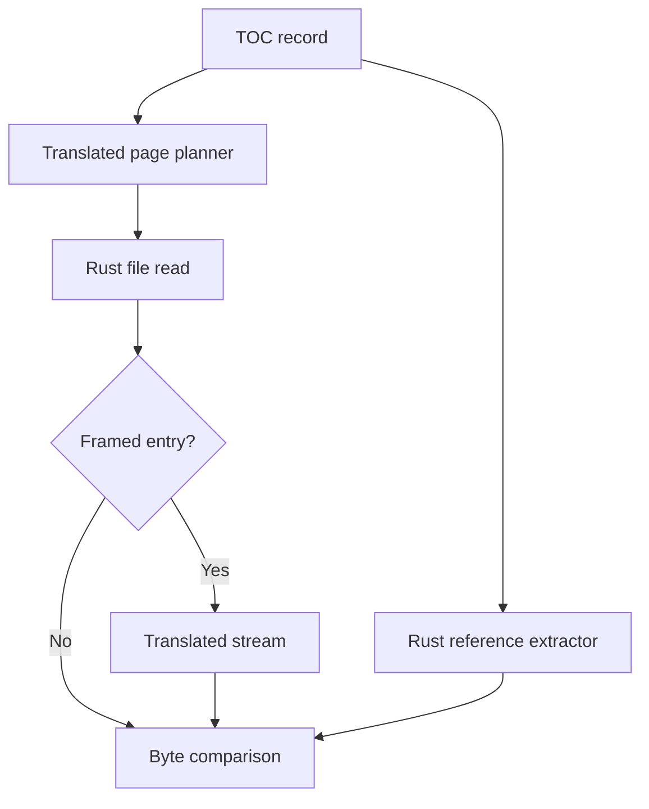

# Warframe U5.1 cache recompilation internals

This document describes v0.6.0 and the 32-bit Windows build `2012.12.31.16.20`.
The project recompiles the game's synchronous path for reading and decoding a
nonempty whole cache entry. Run the project with the commands in
[README.md](README.md).

## From the executable to native code

`lift.py` reads the PE32 image base and section table, maps the
selected relative virtual addresses (RVAs) to file offsets, and checks the
SHA-256 digest of each selected byte range. The decoder's digest includes its
32-entry jump table. The reference `Warframe.exe` has SHA-256
`614c08f25b531d590c5aa6d9cf35b1e406e83d35fbd50e61188f19247fb176ae`.
Generation checks the relevant ranges so an executable with unrelated changes
can still work if those ranges and their addresses match. [lift.py](lift.py)

Capstone decodes the instructions when the script runs. The script groups
instructions into basic blocks and emits Rust statements for register,
memory, and flag operations. Branches select the next compiled block by its
original x86 address. The generated code models 32-bit registers and pointers,
carry and zero flags, and the low 64 bits of `xmm0` used by the selected SSE
instructions. It also preserves guest stack behavior across calls and returns,
including callee stack cleanup where the original specifies it. The host
enters the translated code with a zero return address, which marks the return
to Rust.

Cargo compiles the generated `src/lifted.rs` and the Rust harness for the host.
The executable serves as input to generation. At run time the harness uses
the compiled routines and the installation's `Cache.Windows` directory.

## Cache entry path

The Rust reader takes an offset, packed
length, and decoded length from the TOC. It handles little-endian TOC versions
16 and 20 with 96-byte records. Archive page boundaries and compression block
boundaries are distinct. [src/cache.rs](src/cache.rs)

| Unit | How it is used |
| --- | --- |
| Archive page | The translated `CalculateReadPages` routine chooses the byte span and inclusive 64 KiB page range. The Rust harness reads the relevant part of each page. |
| Unframed entry | When the TOC lengths are equal, the bytes read from the archive are the entry contents. |
| Framed entry | When the TOC lengths differ, the entry contains frames. Each starts with two big-endian 16-bit lengths, packed first and decoded second. This stream path accepts frames up to 16 KiB. |
| Stored frame | Within a framed entry, equal frame lengths select a byte copy. A smaller packed frame length selects LZ decompression. |

The archive wrapper prepares a guest archive operation for a
whole-entry read, calls the translated planner, and checks that the returned
range fits that entry. [src/archive.rs](src/archive.rs)

The stream wrapper supplies guest memory and
passes the complete framed entry to the translated synchronous setup. The
engine code advances through the entry, including refills when it needs to
stage input. The host checks all frame bounds before entry, then checks the
consumed and produced lengths and each LZ call's returned length before
copying the result to the caller. [src/lib.rs](src/lib.rs)

## Routine map

The addresses below are virtual addresses at the reference image base
`0x00400000`. Subtract the base for the RVA used by `lift.py`. Where the
original name is unavailable, the role describes the observed behavior.

| Address | Role |
| --- | --- |
| `0x004A5C60` | `CacheThreadImpl::CalculateReadPages`. Compute the byte span and first and last archive pages. |
| `0x004B1C10` | Call the LZ decoder and report the produced length through an output pointer. Exposed by the standalone `decode_block` helper. |
| `0x004B3290` | Query the output buffer's memory attributes for the stream setup. |
| `0x004B3460` | Construct a stream and initialize its scratch pointers. |
| `0x004B3550` | Calculate space available in the output buffer. |
| `0x004B3590` | Flush staged output into the destination. |
| `0x004B3620` | Copy a stored frame or call the LZ decoder for a compressed frame. |
| `0x004B3730` | Refill staging when input is split at a ring-buffer boundary. |
| `0x004B3860` | Read the next frame header and advance the input ring. |
| `0x004B3930` | Drive decompression of a whole framed entry. |
| `0x004B3AA0` | Bind the input and output buffers, choose the output mode, dispatch to the synchronous driver, and report lengths. |
| `0x00F372B0` | Decode one LZ payload. The literal-run jump table begins at `0x00F37458`. |

## Host calls and supported paths

| Boundary | Harness behavior |
| --- | --- |
| Scratch allocation at `0x00415390` | Supply a single 16-byte-aligned `0xC004`-byte region in the guest arena. |
| Memory move at `0x00F18440` | Use Rust's overlap-safe `copy_within`. |
| `KERNEL32!VirtualQuery` through `0x010A7170` | Return a 32-bit memory-information record for ordinary read/write memory. This lets the translated setup select direct output. |
| Engine diagnostics, interleaving, and job submission | Report an unsupported path if the generated code reaches one of these boundaries. |

The current host supplies TOC reading and file I/O. The translation covers
whole-entry planning from the beginning of an entry and ordinary synchronous
stream setup. Runtime integration needs the surrounding archive objects and
file and job handling to drive the same routines.

## Verification

The reference decoder is the handwritten implementation from the extractor.
The test harness compares
it with the lifted read and decode path byte for byte. A stored frame is
counted within a framed entry, while an unframed entry contributes to its own
entry count. [src/cache.rs](src/cache.rs) · [src/main.rs](src/main.rs)

| v0.6.0 run | Framed entries | Unframed entries | Stored frames | Compressed frames |
| --- | ---: | ---: | ---: | ---: |
| Archived cache, default sample | 40 | 9 | 1 | 187 |
| Windows install with English cache variants, default sample | 44 | 12 | 1 | 192 |
| Archived cache, full comparison | 16,793 | 1,331 | 1,302 | 95,871 |

The full comparison used the same harness path with every nonempty entry
selected. The original x86 page planner was also run independently for all
18,124 archived entries to verify the inclusive page ranges. The Windows
sample reported 25 archives containing sampled compressed frames and passed
all 13 unit tests. The tests cover ring wraparound, whole entries with mixed
frame types, invalid frames, and archive-offset carry across 4 GiB.

## Extending the translation

Start with the exact routine range and the same reference executable. Record
which argument registers, stack slots, return values, and side effects its
caller uses. Verify direct and indirect branch targets before adding the range
and digest to `lift.py`. If a routine crosses into a host call, document the
calling convention and the behavior the host must provide. Add a focused test
for the new behavior and compare it with the original x86 before expanding the
cache sample. Edit the generator or its Rust host code and regenerate
`src/lifted.rs` to try the change.
