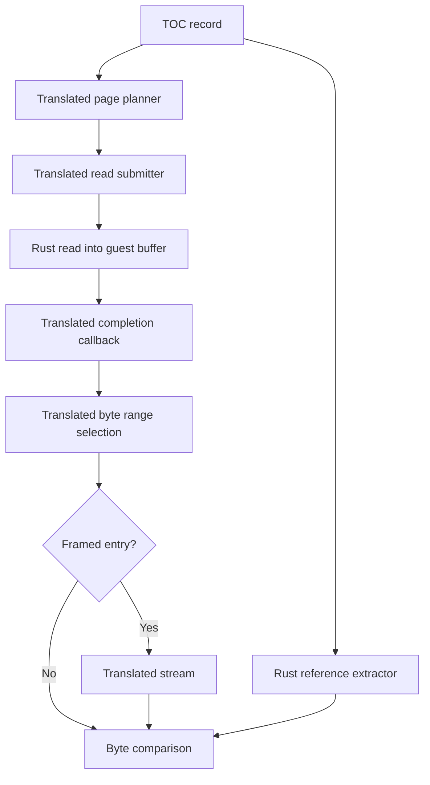

# Warframe U5.1 cache recompilation internals

This document describes v0.10.0 and the 32-bit Windows build `2012.12.31.16.20`.
The project recompiles parts of the game's synchronous path for reading and
decoding a nonempty whole cache entry. Run the project with the commands in
[README.md](README.md).

## From the executable to native code

`lift.py` reads the PE32 image base and section table, maps the
selected relative virtual addresses (RVAs) to file offsets, and checks the
SHA-256 digest of each selected byte range. The decoder's digest includes its
32-entry jump table. The reference `Warframe.exe` has SHA-256
`614c08f25b531d590c5aa6d9cf35b1e406e83d35fbd50e61188f19247fb176ae`.
Generation checks the relevant ranges so an executable with unrelated changes
can still work if those ranges and their addresses match. [lift.py](lift.py)

Capstone decodes the instructions when the script runs. The script groups
instructions into basic blocks and emits Rust statements for register,
memory, and flag operations. Branches select the next compiled block by its
original x86 address. The generated code models 32-bit registers and pointers,
carry and zero flags, and the low 64 bits of `xmm0` used by the selected SSE
instructions. It also preserves guest stack behavior across calls and returns,
including callee stack cleanup where the original specifies it. The host
enters the translated code with a zero return address, which marks the return
to Rust. The page span selector returns at a fixed instruction boundary with
its results in `EDI` and `ESI`.

Cargo compiles the generated `src/lifted.rs` and the Rust harness for the host.
The executable serves as input to generation. At run time the harness uses
the compiled routines and the installation's `Cache.Windows` directory.

## Cache entry path

The Rust reader takes an offset, packed
length, and decoded length from the TOC. It handles little-endian TOC versions
16 and 20 with 96-byte records. Archive page boundaries and compression block
boundaries are distinct. [src/cache.rs](src/cache.rs)

| Unit | How it is used |
| --- | --- |
| Archive page | `CalculateReadPages` chooses the byte span and inclusive 64 KiB page range. `StartIOBufferLoad` converts each page index to an aligned offset and submits a 64 KiB `ReadFileEx` request. `LoadBufferIntoOp` selects the entry bytes within a ready page. |
| Unframed entry | When the TOC lengths are equal, the bytes read from the archive are the entry contents. |
| Framed entry | When the TOC lengths differ, the entry contains frames. Each starts with two big-endian 16-bit lengths, packed first and decoded second. This stream path accepts frames up to 16 KiB. |
| Stored frame | Within a framed entry, equal frame lengths select a byte copy. A smaller packed frame length selects LZ decompression. |



The archive wrapper prepares a guest archive operation for a whole-entry
read, calls the translated planner, and checks that the returned range fits
that entry. It then supplies one guest I/O buffer and file-handle token per
page. The translated submitter writes the 64-bit offset into the guest
`OVERLAPPED` record and passes it to the `ReadFileEx` bridge. Rust seeks to
that offset and reads into the guest buffer. The host retains that guest
state and calls the x86 callback with the byte count and the original
`OVERLAPPED` pointer. The translated completion code finds the buffer in the
thread's array, sets its state from pending (`1`) to ready (`3`), and calls
the semaphore bridge. The host checks for the ready state and one signal,
then passes a guest operation with the entry offset, bytes consumed, and
bytes remaining to the translated prefix of `LoadBufferIntoOp`. The prefix
verifies the page index and file, checks that the operation holds the buffer,
and clamps the range to the end of the current page. At `0x004AA70C`, `EDI`
points to the first byte and `ESI` points one byte past the selected range.
The host checks both pointers against the page and the actual transfer before
appending those bytes. A short final page is accepted when it contains the
entire selected range. [src/archive.rs](src/archive.rs)

The stream wrapper supplies guest memory and
passes the complete framed entry to the translated synchronous setup. The
engine code advances through the entry, including refills when it needs to
stage input. The host checks all frame bounds before entry, then checks the
consumed and produced lengths and each LZ call's returned length before
copying the result to the caller. [src/lib.rs](src/lib.rs)

## Asset preview

The preview finds `Temp/Lotus/Interface/SigninReward/0_flashu.bmp` in
`B.TextureDx9.toc` and reads it with the same translated archive and stream
code as the verifier. That shared entry reader uses the corresponding
`B.TextureDx9.cache` and the decoded length declared by the TOC. The
verifier's separate reference decoder is only used for comparisons.
[src/main.rs](src/main.rs) · [src/preview.rs](src/preview.rs)

This specific cooked texture contains 43,708 bytes of BGRA mip levels ordered
from smallest to largest. The final 32,768 bytes are the 256 × 32 top level.
The preview composites the pixels over black and gives GDI a top-down
32-bit DIB. Rust supplies process startup, window creation, and the event
loop. The translated game code supplies archive reads and decompression.
[src/window.rs](src/window.rs)

## Routine map

The addresses below are virtual addresses at the reference image base
`0x00400000`. Subtract the base for the RVA used by `lift.py`. Where the
original name is unavailable, the role describes the observed behavior.

| Address | Role |
| --- | --- |
| `0x00445B80` | Call `ReleaseSemaphore` to signal that the cache thread has work ready. |
| `0x004A5C60` | `CacheThreadImpl::CalculateReadPages`. Compute the byte span and first and last archive pages. |
| `0x004A6B00` | `CacheThreadImpl::FinishIOBufferLoad`. Locate the pending buffer, mark it ready, update the I/O counters, and signal. |
| `0x004A6BA0` | Check the `ReadFileEx` completion status and byte count, then dispatch to `FinishIOBufferLoad`. |
| `0x004A6C20` | `CacheThreadImpl::StartIOBufferLoad`. Fill the per-page request and call `ReadFileEx`. |
| `0x004AA550`–`0x004AA70C` (end exclusive) | `CacheThreadImpl::LoadBufferIntoOp` prefix. Validate the ready buffer and compute the guest pointers shared by the framed and unframed paths. |
| `0x004B1C10` | Call the LZ decoder and report the produced length through an output pointer. Exposed by the standalone `decode_block` helper. |
| `0x004B3290` | Query the output buffer's memory attributes for the stream setup. |
| `0x004B3460` | Construct a stream and initialize its scratch pointers. |
| `0x004B3550` | Calculate space available in the output buffer. |
| `0x004B3590` | Flush staged output into the destination. |
| `0x004B3620` | Copy a stored frame or call the LZ decoder for a compressed frame. |
| `0x004B3730` | Refill staging when input is split at a ring-buffer boundary. |
| `0x004B3860` | Read the next frame header and advance the input ring. |
| `0x004B3930` | Drive decompression of a whole framed entry. |
| `0x004B3AA0` | Bind the input and output buffers, choose the output mode, dispatch to the synchronous driver, and report lengths. |
| `0x00F372B0` | Decode one LZ payload. The literal-run jump table begins at `0x00F37458`. |

## Host calls and supported paths

| Boundary | Harness behavior |
| --- | --- |
| Scratch allocation at `0x00415390` | Supply a single 16-byte-aligned `0xC004`-byte region in the guest arena. |
| Memory move at `0x00F18440` | Use Rust's overlap-safe `copy_within`. |
| `KERNEL32!VirtualQuery` through `0x010A7170` | Return a 32-bit memory-information record for ordinary read/write memory. This lets the translated setup select direct output. |
| `KERNEL32!QueryPerformanceCounter` through `0x010A709C` | Supply a deterministic zero timestamp for the submitter's timing counters. |
| `KERNEL32!ReadFileEx` through `0x010A71F4` | Capture the request and retain the guest destination and `OVERLAPPED` pointer for completion. Rust serves one page at a time. |
| `KERNEL32!ReleaseSemaphore` through `0x010A719C` | Validate the guest semaphore token and record one release for the current page. |
| Engine diagnostics, interleaving, and job submission | Report an unsupported path if the generated code reaches one of these boundaries. |

The current host supplies TOC reading, synchronous file I/O, and delivery of
successful completions. The translation covers whole-entry planning from the
beginning of an entry, the page submission and completion routines, page
span selection, and ordinary synchronous stream setup. Rust assembles the
selected spans and passes the packed bytes to the translated stream for
framed entries. The original copy and stream-feed branches after the span
checkpoint, buffer release, and the surrounding I/O queue are future
integration points.

## Verification

The reference decoder is the handwritten implementation from the extractor.
The test harness compares
it with the lifted read and decode path byte for byte. A stored frame is
counted within a framed entry, while an unframed entry contributes to its own
entry count. [src/cache.rs](src/cache.rs) · [src/main.rs](src/main.rs)

| Run | Framed entries | Unframed entries | Stored frames | Compressed frames |
| --- | ---: | ---: | ---: | ---: |
| v0.9.0, archived cache, default sample | 40 | 9 | 1 | 187 |
| v0.8.0, Windows install with English cache variants, default sample | 44 | 12 | 1 | 192 |
| v0.9.0, archived cache, full comparison | 16,793 | 1,331 | 1,302 | 95,871 |

The full comparison used the same harness path with every nonempty entry
selected. The original x86 page planner was also run independently for all
18,124 archived entries to verify the inclusive page ranges. The original
x86 submitter and completion path were checked at all 5,303 distinct page
indices used by that archive set and at two synthetic short transfers above
4 GiB. Running the original x86 span selector independently matched all
29,917 page spans used by those entries and three synthetic entries above
or crossing 4 GiB. The v0.8.0 Windows sample covered 25 archives with
compressed frames and passed 17 unit tests. The v0.9.0 Linux run passed 18,
including a check that the selector accepts a ready buffer above 4 GiB and
rejects a pending buffer.

The v0.10.0 Linux run passed 19 unit tests and matched the v0.9.0 default
sample counts. The preview decoded the asset's three compressed frames.
A test harness supplied stand-ins for the Win32 window and paint functions
and compared all 32,768 bytes sent to the paint call with the independently
extracted and composited texture. The user's native Windows run also passed
all 19 unit tests and displayed the 256 × 32 SigninReward texture with
`--window`.

## Extending the translation

Start with the exact routine range and the same reference executable. Record
which argument registers, stack slots, return values, and side effects its
caller uses. Verify direct and indirect branch targets before adding the range
and digest to `lift.py`. If a routine crosses into a host call, document the
calling convention and the behavior the host must provide. Add a focused test
for the new behavior and compare it with the original x86 before expanding the
cache sample. Edit the generator or its Rust host code and regenerate
`src/lifted.rs` to try the change.

## Verified startup checkpoint (2026-11-19, Windows)

The next milestone is implemented locally on top of v0.10.0. The native
executable now enters translated code at the original PE entry point and
reaches `STARTUP_COOKIE_READY`. This is the first CRT initialization step;
it does not yet run WinMain, initialize the engine, or display the title screen.

### Entry path and discovery

The verified PE32 AddressOfEntryPoint is RVA `0x00B17D46` (VA
`0x00F17D46`). Its `call 0x00F23039` initializes the CRT security cookie,
returns to `0x00F17D4B`, then jumps to `0x00F17BD9`. We stop before executing
that jump destination and name it `STARTUP_COOKIE_READY`. The initializer
writes the cookie at `0x01310B30` and its bitwise complement at `0x01310B34`.

`lift.py` now also invokes `startup_lift.py`, producing the ignored local
`src/startup_lifted.rs`. The startup lift checks the full reference executable
SHA-256 listed above and the PE entry point. Recursive discovery begins at
the entry, follows direct calls, unconditional branches, both conditional
successors, and call continuations, and terminates at returns or explicit
checkpoints. It discovers 56 instructions within the entry range
`[0x00F17D46, 0x00F17D50)` and initializer range
`[0x00F23039, 0x00F230D4)`. These bounds admit the selected routines without
prelisting their blocks or branch targets. Unreachable bytes are not decoded.

Discovery rejects unsupported instructions, indirect calls/imports, overlapping
instructions, truncated instructions, and out-of-scope targets with their
addresses. Both discovery and execution have a 512-step/instruction budget.
Four synthetic-PE Python tests cover calls, branches, unreachable bytes,
checkpoints, rejected targets/imports/instructions, overlap, truncation, and
the discovery budget. The shared instruction translator now supports `not`
and `leave`; startup emits Rust using that translator and original stack
call/return conventions. The established cache emitter remains in use.

### Rust and Windows API boundary

`src/startup.rs` supplies zeroed guest memory, ESP `0x00020000`, zero initial
registers, a selected initial cookie, and an intentionally stale complement
`0xDEADBEEF`. Rust supplies these deterministic import fixtures; the translated
original instructions combine the values, select the initialization branch,
and write both globals. These fixtures are for verification, not production
security entropy. The import names were checked against the original PE import
table, all in `KERNEL32.dll`:

| IAT slot | Import | Fixture |
| --- | --- | --- |
| `0x010A7268` | `GetSystemTimeAsFileTime` | Writes `0x1122334455667788` through its argument. |
| `0x010A7138` | `GetCurrentProcessId` | Returns `0x1234`. |
| `0x010A7154` | `GetCurrentThreadId` | Returns `0x5678`. |
| `0x010A7304` | `GetTickCount` | Returns the selected entropy XOR all other entropy components. |
| `0x010A709C` | `QueryPerformanceCounter` | Writes `0x0102030405060708`, returns 1. |

The pointer-taking imports consume one stdcall argument; the other imports
consume none. The FILETIME fixture also sets EAX to 1 for repeatability,
although that void API's return register is not used. The initialized-cookie
path calls none of these imports. The startup fixture is separate from the
cache's existing zero-timestamp counter shim.

### Independent original-x86 comparison

`verify_startup.py` runs the original PE machine bytes in Unicorn 2.1.4 x86-32
on Windows. It maps the original sections, starts at the PE entry, replaces
only the five IAT slots with hooked API fixtures, and stops at `0x00F17BD9`.
It does not execute generated Rust or implement the cookie algorithm in Python.
It compares both globals, final ESP, and the ordered import-slot trace with
output from the native release executable under the same initial state and
API inputs. This is emulated original x86, not a live launch of Warframe.exe.

All six cases matched, with ESP restored to `0x00020000` in each:

| Initial cookie | Combined entropy | Final cookie | Complement | API calls |
| --- | --- | --- | --- | ---: |
| `BB40E64E` | `12345678` | `12345678` | `EDCBA987` | 5 |
| `87654321` | `12345678` | `87654321` | `789ABCDE` | 0 |
| `BB40E64E` | `BB40E64E` | `BB40E64F` | `44BF19B0` | 5 |
| `BB40E64E` | `00001234` | `57351234` | `A8CAEDCB` | 5 |
| `00001234` | `00000000` | `47110000` | `B8EEFFFF` | 5 |
| `BB40E64E` | `FFFF0000` | `FFFF0000` | `0000FFFF` | 5 |

The oracle checks that these runs collectively execute all 56 discovered
instructions, and fails on mismatches, missing coverage, or an execution
budget failure. This covers the existing-cookie shortcut, ordinary seeding,
default-cookie collision, and high-word repair.

### Reproduce and regression results

Run from CMD in the repository root. Install verification dependencies once:

```cmd
py -m pip install -r requirements-verify.txt
verify-startup.cmd "D:\Warframe 2012"
```

The script generates both Rust translations, runs Python discovery tests,
runs Cargo tests and the release build offline, performs the x86 comparison,
and runs the cache and asset checks. It stops on any failure. For just the
compiled checkpoint (no original executable or cache read needed):

```cmd
target\release\warframe-u51-decoder-recomp.exe . --startup
```

Verified locally on Windows on 2026-11-19:

- Four Python discovery tests passed.
- All 20 Rust unit tests passed (17 library and 3 executable tests; baseline
  19 plus the startup branch test). Release build passed without warnings.
- `PASS: 6 original-x86 comparisons; all 56 reachable instructions exercised.`
- Cache sample: 44 framed entries, 12 unframed entries, one stored frame,
  `PASS: 192 compressed blocks matched across 25 archives.`
- Asset: 43,708 decoded bytes, 256 x 32 pixels, three compressed frames.

No window/rendering code was changed for this milestone. The optional
`--window` desktop check was not rerun. All results above are headless.
Original installation files were read only; generated translations remain
ignored and no original code bytes or extracted assets are added to Git.

### Next concrete boundary

The last verified checkpoint is `0x00F17BD9`. The next startup instructions
push `0x58` and `0x01286050`, then call `0x00F21D70` at `0x00F17BE0`.
That exception-registration helper first pushes handler `0x00F19540`, then
executes `push dword ptr fs:[0]` at `0x00F21D75`. The current lifter rejects
this segment-relative memory access. The next step is to model the guest
TEB/SEH chain and verify this prologue before admitting it into the scope.
Do not skip its stack/frame effects.

After the helper, calls at `0x00F17BE9` and `0x00F17BFE` use unresolved IAT
slots `0x010A7280` (`GetStartupInfoW`) and `0x010A727C`
(`HeapSetInformation`), respectively. The PE-header check at `0x00F17C09`
also uses a 16-bit memory/register comparison, outside the present operand
support. These instructions and imports were inspected, not executed or
claimed as translated by this milestone.

## SEH registration and PE classification verified (2026-11-19)

The previous `fs:[0]` boundary is now translated. Recursive startup discovery
covers 108 instructions through `0x00F17C4D`, retaining the cookie checkpoint.
Additional checkpoints are `0x00F17BE5` (SEH prologue returned) and
`0x00F17C4D` (startup information and PE classification ready), reported as
`STARTUP_FRAME_READY` with the stop address.

Rust supplies a guest TEB at `0x10000`; segment-relative operands address this
TEB. The original helper at `0x00F21D70` builds the registration record and
writes its head. It preserves the supplied previous chain (`FFFFFFFF` or
`00018000`), installs handler `00F19540`, and encodes the scope-table pointer
using the translated security cookie. At both checkpoints ESP is `0001FF84`,
EBP is `0001FFFC`, and `fs:[0]` is `0001FFEC`. This implements registration,
not exception dispatch or unwinding yet.

The startup prefix now calls fixture `GetStartupInfoW` (68-byte zeroed record
with cb=68) and, when the original global selects it, `HeapSetInformation`
with verified arguments `(NULL, 1, NULL, 0)` and success return. Original
instructions inspect locally generated PE header bytes and select the managed
image flag at `[EBP-0x1C]`. Six header fixtures cover the actual PE and invalid
DOS signature, invalid PE signature, wrong optional-header magic, too few data
directories, and a nonzero CLR directory. These are verification fixtures;
production process startup and real heap behavior remain to be integrated.

The x86 oracle now uses actual GDT descriptors (32-bit CS/DS/ES/SS and a
nonzero-base FS), so original segment instructions execute unmodified.
Twelve frame cases compare the whole 144-byte stack region, EBP, ESP, the
TEB head, and ordered import calls. This exposed missing residual import
return-address writes in the translation; the emitter now models those calls'
stack writes as well as argument cleanup. PUSH also evaluates its source
before decrementing ESP, required for stack-relative source operands.

`verify-startup.cmd "D:\Warframe 2012"` passed: 20 Rust tests, four Python
discovery tests, six cookie comparisons and twelve frame comparisons with all
108 discovered instructions exercised, plus unchanged cache (192 compressed
blocks / 25 archives) and asset (43,708 bytes / 256 x 32) results. No server
was used. The title screen and playable tutorial are not reached yet.

Next action: translate the CRT heap initialization called at `00F17C4D`
(target `00F2301B`), then thread/runtime initialization. Later login/tutorial
launch arguments are `-webserver:http://localhost/api/ -language:ru -fullscreen:0`;
use the same arguments for the recompiled executable once its launch path is
available. Title-screen verification must remain independent of the server.

## Heap creation and TLS API selection verified (2026-11-19)

The startup group now discovers 162 instructions. Translated `00F2301B`
calls `HeapCreate` through slot `010A7300` with `(0, 0x1000, 0)`, stores the
result at `01358C78`, and converts it to a boolean. The success path enters
`00F22EA0`; the failure case is stopped at `00F17C56` before CRT error handling.
The CRT looks up KERNEL32 with `GetModuleHandleW` (`010A70A4`), then resolves
FlsAlloc/FlsGetValue/FlsSetValue/FlsFree using `GetProcAddress` (`010A70A8`).
The four register-indirect calls at `00F22ECA`, `00F22ED7`, `00F22EE4`, and
`00F22EF1` are now translated with an explicit checked import target.

At `00F22F41`, all four returned APIs are installed in globals
`01358C68`/`6C`/`70`/`74` if present. If any is absent, original instructions
select the whole TLS fallback group: original wrapper `00F22B05`, TlsGetValue
(`010A72EC`), TlsSetValue (`010A72F0`), and TlsFree (`010A72F4`). Original
module/API strings are read from locally generated, ignored initializer data.
Import slots use deterministic guest tokens in both the translation and oracle.

Eight new x86 comparisons cover heap failure, module lookup failure, complete
FLS availability, no FLS availability, and each missing FLS API individually.
All match EAX, ESP, EBP, the heap global, four dispatch globals, and ordered
API calls. This verifies dispatch selection, not yet TLS allocation or use.
Heap/module handles and procedure results are still explicit test fixtures.

`verify-startup.cmd "D:\Warframe 2012"` passed again: 20 Rust tests, four
Python tests, 26 original-x86 cases, every one of 162 discovered instructions,
and unchanged cache and asset checks. Next action: original TlsAlloc at
`00F22F41`, TlsSetValue at `00F22F5C`, encoded API pointers, and CRT lock/thread
state initialization. No server is involved in these process-startup steps.

## TLS state and encoded callbacks verified (2026-11-19)

Startup discovery now covers 249 instructions, stopping at `00F22FA5` before
CRT lock initialization. Original code calls TlsAlloc (`010A7088`), writes its
index to `01310EF4`, and uses TlsSetValue (`010A72F0`) to store the selected
getter. It then calls the group rooted at `00F20730`, including seven newly
reachable small routines, to initialize encoded null/callback globals before
encoding the four TLS/FLS dispatch pointers.

The EncodePointer fixture (`010A7284`) uses XOR `A5A55A5A`; this represents an
opaque reversible encoding for comparisons, not a claim about Windows'
private encoding algorithm. The selected callback at `00F2E465` is encoded
but not invoked. TLS fixtures retain the stored value and validate the index.
Four additional original-x86 cases cover FLS and TLS success, TlsAlloc failure,
and TlsSetValue failure; failures stop at `00F23016` before cleanup. All 30
cases (six cookie, twelve frame, twelve runtime) match, covering all 249
instructions. Runtime comparisons include nine newly initialized callback
globals, the TLS index/value, and the four encoded dispatch pointers.

`verify-startup.cmd "D:\Warframe 2012"` passes with unchanged tests/cache/asset
results. Next: translate CRT lock-table traversal at `00F21BBC`, including the
signed loop branch at `00F21BF2` and InitializeCriticalSectionAndSpinCount
through `010A71A4`. This remains process initialization; no title screen yet.

## CRT lock table verified (2026-11-19)

The group now discovers 276 instructions and reaches `00F22FAA` after the
original lock initializer at `00F21BBC` returns. The original 36-entry static
lock table is included in ignored generated initializer data. The loop creates
14 critical-section records in the successful case, using 24-byte guest
records beginning at `013580B8`. Translated code writes their pointers to the
lock table; the API fixture validates spin count 4000 and initializes the
record. Failing the first or seventh API call returns EAX=0 and clears the
failed table pointer; success returns EAX=1.

Three more original-x86 comparisons verify the full 288-byte pointer/type
table and 864-byte critical-section storage, in addition to existing runtime
state and call traces. All 33 cases match and exercise all 276 instructions.
The execution budget is now 4096 instructions to accommodate the loop.
The translator supports the loop's signed `jl` using CMP's width-correct SF
and OF; it rejects signed branches without an immediately preceding CMP or
with alternate direct entries, rather than silently reusing stale flags.

`verify-startup.cmd "D:\Warframe 2012"` passes the startup/cache/asset checks.
The last verified startup state is CRT locks ready at `00F22FAA`; the next
step is decoding and invoking the selected FlsAlloc/TlsAlloc function at
`00F22FBF`/`00F22FC1`, allocating the `0x214`-byte per-thread CRT data block
through `00F22053`, and initializing it through `00F22BBC`. API fixtures still
need a production backend; actual engine/window startup remains ahead.

## Per-thread TLS/FLS slot verified (2026-11-19)

The next prefix decodes the selected allocator and executes the indirect call
at `00F22FC1`. The generator now supports a verified indirect target set that
can contain both imports and original guest functions. FLS uses the host
FlsAlloc token with original cleanup callback `00F22D03`; TLS fallback executes
the original wrapper at `00F22B05`, including its `ret 4` argument cleanup.
This call is not replaced with a handwritten shortcut.

The allocated per-thread slot is stored at `01310EF0`. Four added x86 cases
cover FLS/TLS success and failure. Success stops at `00F22FCD` before allocating
the CRT thread-data block, and failure stops at `00F23011` before cleanup.
The verifier compares the new slot along with prior state, stack, and ordered
calls. Both TLS-index initializers now come from original PE data rather than
zero defaults. `verify-startup.cmd "D:\Warframe 2012"` passes all 37 x86 cases,
20 Rust tests, five discovery tests, and cache/asset regressions.
Next: translate calloc's group rooted at `00F22053` / `00F3038D`, then store
and initialize the resulting `0x214`-byte per-thread data block.

## CRT calloc and thread-data allocation verified (2026-11-19)

Discovery now includes the group rooted at `00F22053` and `00F3038D`, adding
32-bit unsigned division and two-operand signed multiplication. The original
calloc code performs its overflow check, multiplies count by element size,
requests zero-filled memory from HeapAlloc (`010A7328`), and handles a null
result. Rust supplies a bounded guest heap; the translated CRT performs the
allocation policy. Division faults report an address instead of wrapping.

At `00F22FE1`, the original startup has allocated its `0x214`-byte thread-data
block at guest `00080000`. A second case reaches the allocation-failure
boundary `00F23011`. Six direct original-x86 allocator cases additionally
exercise zero count, the error-output pointer, overflow rejection at
`00F303A5`, the unimplemented new-handler boundary at `00F303E3`, successful
retry, and retry timeout. Sleep is a recorded deterministic fixture and does
not delay tests. The oracle compares return values, stack cleanup, allocation
attempts, error output, and a 1 KiB heap region initially filled with A5, so
zero-initialization and untouched surrounding memory are both checked.

`verify-startup.cmd "D:\Warframe 2012"` passes: 45 original-x86 cases exercise
all 362 discovered instructions; 20 Rust and five discovery tests pass;
cache and asset checks remain unchanged. Allocator error/new-handler routines
are explicit unresolved boundaries, not replaced with successful behavior.
Next: store the thread-data pointer through the selected FLS/TLS setter, then
translate the initializer at `00F22BBC`, including its nested SEH frame,
locale references, lock acquisition/release, and SEH epilogue.

## CRT per-thread initialization verified (2026-11-19)

The native translated PE path now returns from CRT thread initialization at
`00F17C63` with EAX=1. The group covers 521 instructions. It stores the new
thread-data pointer through the selected FLS/TLS setter, executes `00F22BBC`,
and restores the outer SEH chain through the original epilogue `00F21DB5`.
The thread object contains the original thread ID, invalid-handle sentinel,
C-locale and multibyte pointers, default flags, and character markers.

Locale handling is translated through `00F25870`; Rust supplies only the
InterlockedIncrement boundary. The original code increments all applicable
reference counts. Original lock wrappers acquire/release the initialized
locale locks through modeled critical-section operations. Lazy lock creation
at `00F21D4B` remains an explicit boundary because these startup locks already
exist. Thread/FLS cleanup callbacks are registered but not yet dispatched.

Startup initialization now loads all non-executable PE sections into guest
memory from locally generated `src/startup_data.bin`, which is ignored by Git.
Executable sections are excluded; instructions still run as compiled Rust.
This replaces manually selected initializer slices and makes the original
locale and reference tables available for further engine startup.

The oracle verifies all `0x214` thread-object bytes, the original static locale
region, TLS/FLS contents, lock records, EAX/ESP/EBP, and restored TEB head.
Added cases cover full FLS/TLS success and a setter failure. A synthetic locale
case exercises optional reference pointers and six category entries, comparing
a full 4 KiB region. All 49 original-x86 cases exercise all 521 instructions.
`verify-startup.cmd "D:\Warframe 2012"` passes, including 20 Rust tests, five
Python tests, and unchanged cache and asset results.

Next: the empty CRT initializer range at `00F22AB0`, then low-level CRT file
handle initialization at `00F21DC9`. WinMain is at `00401140` (called from
`00F17CEE`); the remaining CRT path must run before entering it. The game title
screen and tutorial have not been reached. No server or network was used.

## CRT descriptor-table allocation verified (2026-11-19)

The PE path now runs the empty CRT initializer traversal (`00F22AB0` has
identical start/end constants `01285CB0`) and enters low-level I/O setup at
`00F21DC9`. The unneeded initializer callback-body path remains an explicit
boundary at `00F22AC4`; no callback is skipped on the verified path.
Original code allocates 32 64-byte descriptor records, sets invalid-handle and
text-mode defaults, and publishes the pointer/count globals `01359CA0` and
`01359C88`. Success reaches `00F21E42`; a failed second HeapAlloc returns -1
at `00F17C7C`. Both cases match original x86, including all 2048 table bytes.

`verify-startup.cmd "D:\Warframe 2012"` passes 51 original-x86 cases covering
all 579 discovered instructions, with unchanged Rust/discovery/cache/asset
results. Next: initialize stdin/stdout/stderr from GetStdHandle/GetFileType,
then process command-line/environment setup before the CRT initializer arrays.
Inherited CRT descriptor data is a separate path to implement explicitly.

## CRT standard handles verified (2026-11-19)

The supported non-inherited descriptor path now returns from `00F21DC9` to
`00F17C7C`, with EAX=0 on success. Original code requests stdin/stdout/stderr
using GetStdHandle (`010A72D4`), queries GetFileType (`010A72D8`), sets the
text/character/pipe flags, initializes each descriptor's lock, and calls
SetHandleCount (`010A72D0`). Handle tokens and API responses are fixtures;
actual process I/O handles are not yet bridged. This is verified CRT behavior,
not a claim that engine startup or rendering runs.

Eight additional cases cover complete FLS and TLS paths through I/O setup,
a nonzero reserved-data length with null pointer, null standard handles,
INVALID_HANDLE_VALUE, failed file-type queries, a standard-descriptor lock
failure, and the inherited-descriptor boundary. Inherited CRT descriptor data
stops explicitly at `00F21E59`; a pre-populated descriptor path at `00F21F70`
is also deferred. Current fresh tables contain invalid handles, so neither
path is needed for the verified non-inherited startup. The verifier compares
all descriptor bytes, published globals, lock state, thread/locale state,
return values, stack, and call order.

The final `verify-startup.cmd "D:\Warframe 2012"` run passed: 59 original-x86
cases exercised all 643 discovered instructions; all 20 Rust and five Python
tests passed; the cache remained 44 framed / 12 unframed / one stored frame /
192 compressed blocks across 25 archives; the preview asset remained 43,708
bytes and 256 x 32 pixels. Full local output is in ignored
`target/startup-verification.log`. No desktop window or server was used.

Next action: extend the caller from `00F17C7C` through its signed return-value
check, GetCommandLineA (`010A7278`), and the environment getter at `00F22A19`.
The import table confirms GetEnvironmentStringsW (`010A72E4`),
WideCharToMultiByte (`010A72C4`), and FreeEnvironmentStringsW (`010A72E0`).
Environment allocation uses `00F2200E` / `00F26278`. Argument parsing follows
at `00F2295E`, calling `00F227C4`, before the CRT initializer arrays and WinMain
at `00401140`. Preserve `-webserver:http://localhost/api/ -language:ru
-fullscreen:0` for later login/tutorial runs. The title-screen/playable-tutorial
goal remains active and unverified; the next work does not require a server.

## Command line and ANSI environment verified (2026-11-19)

The translated entry path now passes the signed result check at `00F17C7C`,
captures GetCommandLineA (`010A7278`) in `01359DB8`, executes the original CRT
environment converter at `00F22A19`, and publishes its return value in
`01358030` at the named `00F17C9D` checkpoint. Logical instructions now model
SF/OF for TEST and support JNS and arithmetic right shift. The successful
fixture converts the UTF-16 block `A=B\0LANG=ru\0\0` to 13 ANSI bytes at guest
`00080A20`; the null-environment fixture returns zero. Both results, heap state,
stack/frame state, import order, command-line pointer, and converted bytes match
the original x86 under Unicorn.

The allocation path is translated through `00F2200E` and `_malloc` at
`00F26278`. Rust supplies deterministic GetCommandLineA,
GetEnvironmentStringsW, WideCharToMultiByte, FreeEnvironmentStringsW, and
HeapAlloc fixtures. The CRT scans the double-NUL block, computes the character
count, requests the conversion size, allocates, performs the conversion, frees
the Windows environment block, and returns the ANSI pointer. Explicit next-run
boundaries are the prior CRT failure handler `00F17C80`, malloc retry
`00F22026`, conversion cleanup/failure at `00F22A8A`/`00F22AA2`, lazy heap
initialization `00F26291`, zero-size allocation `00F262B1`, allocation failure
`00F262C9`, and oversize allocation `00F262F5`.

REA MCP 6.9.0 was available with the Windows Ghidra provider and opened the
same SHA-256 used by the generator. Focused headless summaries identified
`00F22A19` as `___crtGetEnvironmentStringsA` (retained Evidence
`ev_435ef2c46832809d311635122e8c7aab8f76e653b3328ce072746c01854a3cca`),
`00F26278` as `_malloc`
(`ev_d033217d566803a2f504a11ef5963d576fc34c5ee8941ce8a31282eaa668caa8`),
and the following `00F2295E` routine as `__setargv`
(`ev_597c5e1d6c1069c1b1c0ae4ced16cad5cbbd682d2cf90ee8fc4aba381029d21e`).
The retained environment pseudocode corroborates the translated control flow;
it is static Ghidra evidence, while the Unicorn comparisons establish execution.

`verify-startup.cmd "D:\Warframe 2012"` passes 61 original-x86 comparisons
(six cookie, twelve frame, 34 runtime, six allocator, one locale, and two
environment cases) and exercises all 760 instructions in the supported bounded
group. All 20 Rust tests and five discovery tests pass. Cache regression remains
44 framed entries, 12 unframed entries, one stored frame, and 192 compressed
blocks across 25 archives; the asset remains 43,708 bytes and 256 x 32 pixels.
The output is recorded in ignored `target/startup-verification.log`.

Next: translate `__setargv` at `00F2295E` and its command-line tokenizer at
`00F227C4`, verify argc/argv and copied argument bytes at `0135806C` and
`01358070`, then continue through the remaining CRT initializer arrays toward
WinMain at `00401140`. Preserve the later login/tutorial arguments
`-webserver:http://localhost/api/ -language:ru -fullscreen:0`.

## argv and environment vector verified (2026-11-19)

The translated entry path now executes `__setargv` at `00F2295E`, including
the tokenizer at `00F227C4`, and then the environment-vector initializer at
`00F226E8`. The command-line fixture is `Warframe.exe -language:ru
-fullscreen:0`. At checkpoint `00F17CAE`, both implementations publish argc=3
at `0135806C` and argv=`00080A30` at `01358070`; the three pointers, terminating
null pointer, and copied argument bytes match. At checkpoint `00F17CBF`, both
publish envp=`00080A70` at `01358078`, containing `A=B`, `LANG=ru`, and a null
pointer, and set the initialized flag at `01359DA0` to one. The heap ends at
`00080AA0` in both runs.

The generator gained MOVSX and SETE and discovers the newly reachable direct
calls and branch targets as a group. Rust supplies deterministic
GetModuleFileNameA, strlen, bounded-copy, and free boundaries; original x86
performs command-line counting/copying and environment filtering/allocation.
Quoted/DBCS tokenizer alternatives, allocation failures, the absent-environment
return at `00F22704`, and the already-initialized ctype call at `00F226F1` are
explicit unresolved boundaries. They are not counted as exercised behavior.

`verify-startup.cmd "D:\Warframe 2012"` passes 63 original-x86 comparisons
(six cookie, twelve frame, 34 runtime, six allocator, one locale, two
environment, one argv, and one envp) and exercises all 1,027 instructions in
the supported bounded group. All 20 Rust tests and five Python tests pass. The
cache still matches 44 framed entries, 12 unframed entries, one stored frame,
and 192 compressed blocks across 25 archives; the preview asset remains 43,708
bytes with a 256 x 32 top mip.

Focused headless Ghidra summary requests for `00F226E8` and the next routine
`00F20787` were issued through the available REA MCP server, but did not return
within the client window. Direct inspection identifies the next boundary:
`00F20787` encodes ten runtime pointers via `00F23CB4`, walks the CRT
pre-initializer range `010A99F0..010A9A10` through `00F20763`, registers
`00F22AD6`, then begins the large constructor table at
`010A761C..010A99EC`. Later, `00F22689` derives lpCmdLine and `00F17CEE` calls
WinMain at `00401140`.

Last verified checkpoint: `00F17CBF`, immediately before the call to
`00F20787`. Next: translate the direct path through `00F20787` to the first
indirect pre-initializer boundary, resolve and verify the seven non-null
pre-initializer entries, then continue to `00F22689` and WinMain. The title
screen remains unverified, and no SpaceNinjaServer process or network service
was used by these headless checks.

## CRT pre-initializers verified (2026-11-19)

The translated entry path now enters `__cinit` at `00F20787`. The named
`STARTUP_CINIT_POINTERS_READY` checkpoint at `00F207B3` verifies all ten slots
at `01310EF8..01310F1C` after the original loop at `00F23CB4` encodes them.
The PE's raw-DLL callback is `00F18111`; Rust supplies the executable-image
pointer predicate and raw-DLL callback boundaries while the translated wrapper
performs the tests, arguments, calls, and stack cleanup.

The seven-entry pre-initializer table `010A99F0..010A9A10` is now a closed
indirect target set. Original translated code executes entries `00F179F2`,
`00F182B1`, `00F192AB`, `00F231D7`, `00F25852`, `00F2615A`, and `00F22323`.
At `STARTUP_PREINITIALIZERS_READY` (`00F207C4`), the original and translated
runs agree on the 20-entry CRT stream-pointer table, its pointed-to values,
the encoded 128-byte atexit allocation, captured system time, processor-feature
globals, ctype flag, guest-heap end, registers, stack, and ordered host calls.
Rust supplies deterministic IsProcessorFeaturePresent and
SetUnhandledExceptionFilter results. Allocation retry/failure and alternate
already-sized table branches remain explicit boundaries.

The lifter now supports JGE with validated CMP flag provenance and permits a
verified indirect call set through either a register or an absolute pointer.
Indirect cdecl host boundaries use caller cleanup, matching direct calls.

REA's focused Ghidra fast path identified `00F20787` as `__cinit` and retained
Evidence `ev_a31c5fa1e63e86c8ef4b8f68505cc174d8deae9fd129e9e4f0eceda82eca3a64`.
It identified `00F1831E` as `_atexit` (Evidence
`ev_ac095e1921bd0cdf4a533749192b9764448ae8e707ed6af6a604b2ed8a46fb20`)
and `00F22689` as `__wincmdln` (Evidence
`ev_976504471a805abe41c53830c20dfc3edb359a29e097fae08e226e8800197ebd`).
The earlier summary timeout was a client observation limit; the live REA
session and these later focused results confirm the server and Ghidra provider
remain usable.

`verify-startup.cmd "D:\Warframe 2012"` passes 65 original-x86 comparisons
and exercises all 1,184 instructions in the supported bounded group. All 20
Rust tests and five Python tests pass. Cache and asset evidence remains 44
framed entries, 12 unframed entries, one stored frame, 192 compressed blocks
across 25 archives, and a 43,708-byte 256 x 32 preview asset.

Last verified checkpoint: `00F207C4`, after every CRT pre-initializer returns
zero. Next: translate `_atexit` registration of callback `00F22AD6`, then
inventory and execute the constructor table `010A761C..010A99EC`. After
`__cinit` returns, translate `__wincmdln` and enter WinMain at `00401140`.
The title/login screen and UI input remain unverified. SpaceNinjaServer was not
started or contacted.

## atexit and first constructors verified (2026-11-19)

The original `_atexit` path at `00F1831E` is now translated through its SEH
wrapper, lock acquire/release, encoded callback-table access, and success
normalization. `STARTUP_ATEXIT_READY` at `00F207D4` verifies that callback
`00F22AD6` occupies the first four-byte slot and that the encoded end pointer
advanced exactly once. Rust supplies the allocation-size query for the guest
heap allocation; growth/reallocation and corrupt-pointer branches remain
explicit boundaries.

The constructor table contains 2,292 entries, of which 2,290 are nonzero and
all 2,290 targets are unique. The lifter now admits constructor targets in
measured batches and can stop at the first unresolved target with the same
return address already pushed that the original x86 has at function entry.
This makes each batch directly comparable without pretending later constructors
ran.

The first constructor `010670D0` performs a scalar float multiply and stores
the result at `01316330`. MOVSS and MULSS are now translated with exact f32 bit
rounding. The second constructor `010670F0` invokes the translated leaf object
initializer at `00421AE0`, creates the 13-byte object at `01316334`, and
registers destructor `010912E0` through the translated `_atexit` path.
`STARTUP_CONSTRUCTOR_001_READY` stops at `010670F0`,
`STARTUP_CONSTRUCTOR_002_READY` stops at `01067120`, and the same object shape
at `01067120` is verified by `STARTUP_CONSTRUCTOR_003_READY` at `01067150`.
All three match original x86 registers, stack, written bytes, callback bytes,
and ordered host calls.

Focused Ghidra evidence identifies the second constructor's object initializer
as `FUN_00421ae0`, a 32-byte leaf ending in `ret 0xC` (Evidence
`ev_db173f2dc1b330251694228414482770efdf5e3d20d9fc3da8d979942a67925c`).
The next shared object initializer at `00425060` is retained as Evidence
`ev_69d2bb1464eded720351b5a6120956d659fe484ca9a094201a0f9f10f44eedd3`.

`verify-startup.cmd "D:\Warframe 2012"` passes 69 original-x86 comparisons
and exercises all 1,314 instructions in the bounded group. All 20 Rust tests,
five Python tests, cache checks, and the 43,708-byte asset check pass.

Last verified checkpoint: entry of constructor `01067150`, after the first
three constructors have returned. Next: translate the repeated constructor family
rooted at `00425060` and its direct callees in a batch, continuing until the
first genuinely new constructor shape. The later `__wincmdln`, WinMain, title
screen, and UI-input checks remain outstanding. SpaceNinjaServer remained
stopped.
